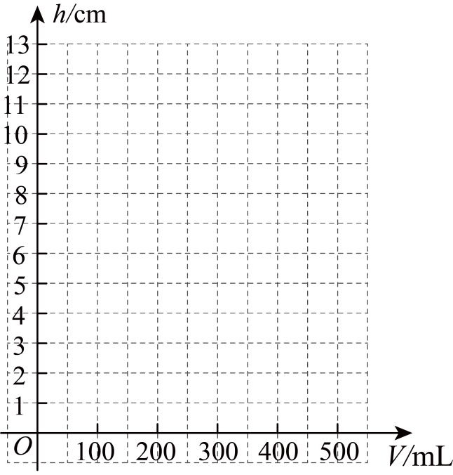

# Mathematics - 题目 2308

**ID**: c3616b4e4b634d84b0eff9fc62be862d
**年级**: Grade 9
**难度**: Medium
**题型**: Calculation

## 题目
小云有一个圆柱形水杯（记为1号杯），在科技活动中，小云用所学数学知识和人工智能软件设计了一个新水杯，并将其制作出来，新水杯（记为2号杯）示意图如下，当1号杯和2号杯中都有 $V{\rm mL}$ 水时，小云分别记录了1号杯的水面高度 $h{{}_{1}}$ （单位：cm）和2号杯的水面高度 $h{{}_{2}}$ （单位：cm），部分数据如下：$V$ /mL040100200300400500$h{{}_{1}}$ /cm02.​​​​​​​‌55.07.510.012.5$h{{}_{2}}$ /cm02.84.87.28.910.511.8（1）补全表格（结果保留小数点后一位）；（2）通过分析数据，发现可以用函数刻画 $h{{}_{1}}$ 与 $V$ ， $h{{}_{2}}$ 与 $V$ 之间的关系.在给出的平面直角坐标系中，画出这两个函数的图象；（3）根据以上数据与函数图象，解决下列问题：①当1号杯和2号杯中都有320mL水时，2号杯的水面高度与1号杯的水面高度的差约为cm（结果保留小数点后一位）；②在①的条件下，将2号杯中的一都分水倒入1号杯中，当两个水杯的水面高度相同时，其水面高度约为cm（结果保留小数点后一位）．

## 解答

1. （1）解：由题意得，设V与 $h{{}_{1}}$ 的函数关系式为： $V=kh{{}_{1}}\left ({k\ne 0}\right )$ ，
2. 由表格数据得： $100=2.5k$ ，
3. 解得： $k=40$ ，
4. ∴ $V=40h{{}_{1}}$ ，
5. ∴当 $V=40$ 时， $40h{{}_{1}}=40$ ，
6. ∴ $h{{}_{1}}=1.0{\rm{c}}{\rm{m}}$ ；
7. （2）解：如图所示，即为所画图象，
8. 
9. （3）解：①当 $V=320{\rm{m}}{\rm{l}}$ 时， $h{{}_{1}}=\frac {320}{40}=8{\rm{c}}{\rm{m}}$ ，由图象可知高度差 $CD\approx 1.2{\rm{c}}{\rm{m}}$ ，
10. 
11. 故答案为：1.2；
12. ②由图象可知当两个水杯的水面高度相同时，估算高度约为 $8.7{\rm{c}}{\rm{m}}$ ，
13. 故答案为： $8.7$ ．

## 知识点

**中文**:
  - 从函数的图象获取信息
  - 用描点法画函数图象

**English**:
  - Extracting Information from Graphs
  - Plotting Graphs by Points

---
