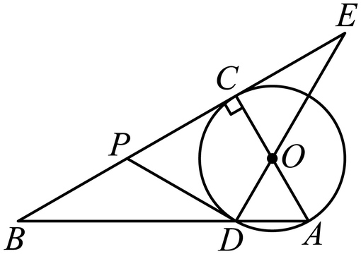

# Mathematics - 题目 2660

**ID**: c7430f3203c4498f81e8726d44bb2a79
**年级**: Grade 9
**难度**: Medium
**题型**: Calculation

## 题目
如图，在 ${\rm{R}}{\rm{t}}\mathrm{△}ABC$ 中， $\angle ACB\mathrm{=}90{}\degree $ ，以 $AC$ 边为直径作 $\odot O$ 交 $AB$ 于点 $D$ ，连接 $DO$ 并延长交 $BC$ 的延长线于点 $E$ ，点 $P$ 为 $BC$ 的中点，连接 $DP$ ．（1）求证： $PD$ 是 $\odot O$ 的切线；​​​​​​​‌（2）若 $\odot O$ 的半径为 ${\rm 2，}\angle B=30{}\degree $ ，求 $PE$ 的长．

## 解答

1. （1）证明：如图，连接 $CD$ ．
2. $\because $  $AC$ 为 $\odot O$ 的直径，
3. $\therefore $  $\angle CDA=90{}\degree $ ，
4. $\therefore $  $\angle CDB=90{}\degree $ ，
5. $\because $ 点 $P$ 为 $BC$ 的中点，
6. $\therefore $  $PD=\frac {1}{2}BC=BP$ ，
7. $\therefore $  $\angle B=\angle PDB$ ，
8. $\because $  $\angle ACB\mathrm{=}90{}\degree $ ，
9. $\therefore $  $\angle B+\angle CAB=90{}\degree $ ，
10. $\therefore $  $\angle PDB+\angle CAB=90{}\degree $ ，
11. $\because $  $OA=OD$ ，
12. $\therefore $  $\angle ODA=\angle CAB$ ，
13. $\therefore $  $\angle PDB+\angle ODA=90{}\degree $ ，
14. $\therefore $  $\angle PDO=90{}\degree $ ，即 $OD\bot PD$ ，
15. 又 $\because $  $OD$ 为 $\odot O$ 的半径，
16. $\therefore $  $PD$ 是 $\odot O$ 的切线；
17. （2）解： $\because $  $\angle B=\angle PDB$ ， $\angle B=30{}\degree $ ，
18. $\therefore $  $\angle PDB=30{}\degree $ ，
19. $\therefore \angle EPD=\angle B+\angle PDB=60{}\degree $ ，
20. $\because $  $\angle PDE=90{}\degree $ ，
21. $\therefore \angle E=30{}\degree $ ，
22. $\because $  $\angle ACB\mathrm{=}90{}\degree $ ，
23. $\therefore $  $\angle ACE=90{}\degree $ ，
24. $\because $  $\odot O$ 的半径为2，
25. $\therefore $  $OE=2OC=2\times 2=4$ ，
26. $\therefore $  $DE=OD+OE=2+4=6$ ，
27. $\because $ 在 ${\rm{R}}{\rm{t}}\mathrm{△}PDE$ 中， $\angle E=30{}\degree $ ，
28. $\therefore $  $PD=\frac {1}{2}PE$ ，
29. 由勾股定理得， $PD{^{2}}+DE{^{2}}=PE{^{2}}$ ，
30. 即 ${\left({\frac {1}{2}PE}\right)^{2}}+6{^{2}}=PE{^{2}}$ ，
31. 解得： $PE=4\sqrt {3}$ ．

## 知识点

**中文**:
  - 切线的判定定理
  - 圆周角定理及推论
  - 解直角三角形

**English**:
  - Tangent Determination Theorem
  - Inscribed Angle Theorem
  - Solving Right Triangles

---
