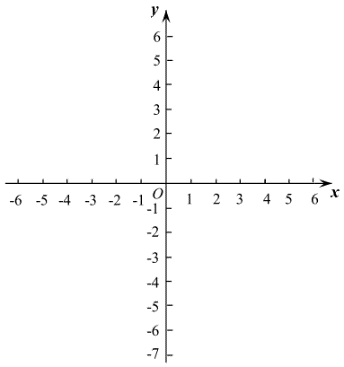

# Mathematics - 题目 3875

**ID**: c96cf01cfd5b4b9bad8346bbfa1c3b96
**年级**: Grade 9
**难度**: Medium
**题型**: Calculation

## 题目
在平面直角坐标系 $xOy$ 中，抛物线 $y=ax{^{2}}+bx-5a$ 与 $y$ 轴交于点 $A$ ，将点 $A$ 向左平移4个单位长度，得到点 $B$ ，点 $B$ 在抛物线上．（1）求点 $B$ 的坐标（用含a的式子表示）；​​​​​​​‌（2）求抛物线的对称轴；（3）已知点 $P\left ({-1,-2a}\right )$ ， $\mathbf{Q}\left ({-4,2}\right )$ ．若抛物线与线段 $PQ$ 恰有一个公共点，结合函数图象，求 $a$ 的取值范围．

## 解答

1. （1）∵抛物线 $y=ax{^{2}}+bx-5a$ 与 $y$ 轴交于点 $A$ ，
2. ∴点A(0，-5a)，
3. ∵将点 $A$ 向左平移4个单位长度，得到点 $B$ ，
4. ∴B(-4，-5a)；
5. （2）对称轴是x= $\frac {0-4}{2}=-2$ ；
6. （3）如图：当a<0时，
7. ∵A(0，-5a),  $P\left ({-1,-2a}\right )$ ,且-5a>-2a，
8. ∴点P在抛物线下方，
9. ∵ $Q\left ({-4,2}\right )$ ，抛物线与线段 $PQ$ 恰有一个公共点，B(-4，-5a)，
10. ∴点Q在抛物线上方或是在抛物线上，即 $2\geqslant -5a$ ，
11. 解得 $a\geqslant -\frac {2}{5}$ ，
12. ∴ $-\frac {2}{5}\leqslant a<0$ 时抛物线与线段 $PQ$ 恰有一个公共点；
13. 
14. 当a>0时，∵A(0，-5a),  $P\left ({-1,-2a}\right )$ ，且-5a<-2a<0，
15. ∴点P在抛物线上方，在x轴下方，
16. ∵ $Q\left ({-4,2}\right )$ ，B(-4，-5a)，
17. ∴点Q在抛物线上方，
18. ∴此时抛物线与线段 $PQ$ 没有公共点；
19. 
20. 综上， $-\frac {2}{5}\leqslant a<0$ 时抛物线与线段 $PQ$ 恰有一个公共点.

## 知识点

**中文**:
  - y=ax²+bx+c的图象与性质

**English**:
  - Graph and Properties of y=ax²+bx+c

---
