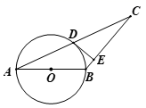

# Mathematics - 题目 74

**ID**: ca2ce48fd98d4a88b4238a3aad37590f
**年级**: Grade 9
**难度**: Medium
**题型**: Calculation

## 题目
如图，AB是⊙O的直径，⊙O过AC的中点D，DE切⊙O于点D，交BC于E．（1）求证DE⊥BC；​​​​​​​‌（2）若⊙O的半径为5，BE＝2，求DE的长度．

## 解答

1. 证明（1）连接OD
2. 
3. ∵DE切⊙O于点D
4. ∴OD⊥DE
5. ∴∠ODE＝90°
6. ∵D是AC的中点，O是AB的中点
7. ∴OD是△ABCD的中位线
8. ∴OD∥BC
9. ∴∠DEC＝90°
10. ∴DE⊥BC
11. （2）过B作BF⊥OD
12. 
13. ∵BF⊥OD
14. ∴∠DFB＝90°
15. ∴∠DFB＝∠DEB＝∠ODE＝90°
16. ∴四边形DFBE为矩形
17. ∴DF＝BE＝2
18. ∴OF＝OD－DF＝5－2＝3
19. ∴DE＝BF＝4

## 知识点

**中文**:
  - 三角形中位线
  - 直角三角形的性质
  - 勾股定理
  - 矩形的判定与性质综合
  - 切线的性质和判定的综合应用

**English**:
  - Triangle Midsegment
  - Properties of Right Triangles
  - Pythagorean Theorem
  - Determination and Properties of Rectangles
  - Tangent Applications

---
