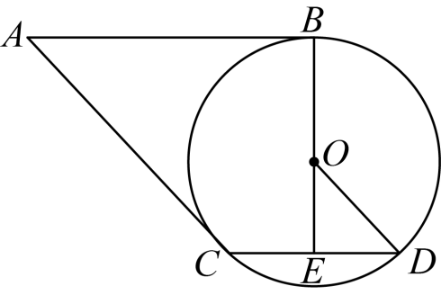

# Mathematics - 题目 3073

**ID**: cafd8ae319264049a8ed6a688aad9a04
**年级**: Grade 9
**难度**: Medium
**题型**: Calculation

## 题目
如图， $AB$ ， $AC$ 分别与 $\odot O$ 相切于 $B$ ， $C$ 两点， $BO$ 的延长线交弦 $CD$ 于点 $E$ ， $CE=DE$ ，连接 $OD$ ．(1)求证： $\angle A=\angle DOE$ ；​​​​​​​‌(2)若 $OD\mathrm{/\mskip-4mu/}AC$ ， $\odot O$ 的半径为 $2$ ，求 $AB$ 的长．

## 解答

1. （1）证明：连接 $OC$ ，如图，
2. 
3. $\because BO$ 的延长线交弦 $CD$ 于点 $E$ ， $CE=DE$ ，
4. $\therefore OE\bot CE$ ，
5. $\because OC=OD$ ，
6. $\therefore \angle DOE=\angle COE$ ，
7. $\because AB$ ， $AC$ 分别与 $\odot O$ 相切于 $B$ ， $C$ 两点，
8. $\therefore \angle ABO=\angle ACO=90{}\degree $ ，
9. $\therefore \angle A+\angle BOC=180{}\degree $ ，
10. $\because \angle BOC+\angle COE=180{}\degree $ ，
11. $\therefore \angle COE=\angle A$ ，
12. $\therefore \angle DOE=\angle A$ ；
13. （2）解：过 $C$ 作 $CH\bot AB$ 于 $H$ ，如图，
14. 
15. 则四边形 $BECH$ 是矩形，
16. $\therefore BH=CE$ ， $CH=BE$ ， $\angle CHA=\angle BHC=90{}\degree $ ，
17. $\because $  $OD\mathrm{/\mskip-4mu/}AC$ ，
18. $\therefore \angle DOC=\angle ACO=90{}\degree $ ，
19. $\because OC=OD=2$ ， $\angle DOE=\angle COE=45{}\degree $ ，
20. $\therefore $ 由（1）可得 $\angle A=\angle DOE=45{}\degree $ ，
21. $\therefore $  $CD=\sqrt {2}OC=2\sqrt {2}$ ，
22. $\therefore CE=DE=OE=\sqrt {2}$ ，
23. $\therefore BE=OB+OE=2+\sqrt {2}$ ，
24. $\therefore AH=CH=BE=2+\sqrt {2}$ ，
25. $\therefore $  $AB=AH+BH=2+\sqrt {2}+\sqrt {2}=2+2\sqrt {2}$ ．

## 知识点

**中文**:
  - 切线长定理
  - 垂径定理及其推论
  - 等腰直角三角形的性质

**English**:
  - Tangent Length Theorem
  - Perpendicular Chord Theorem
  - Properties of Isosceles Right Triangles

---
