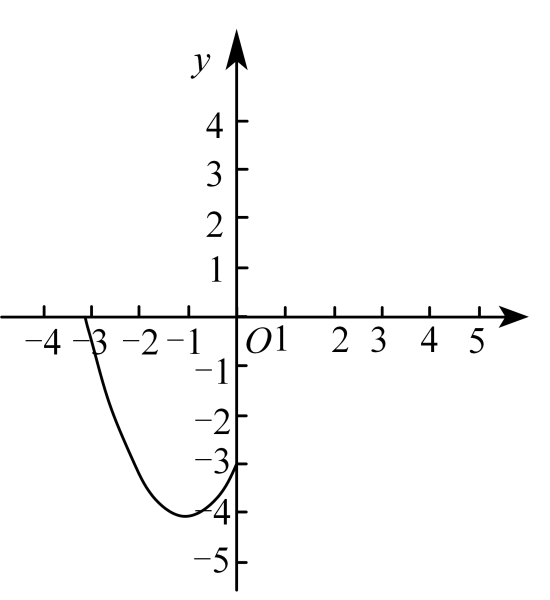

# Mathematics - 题目 2715

**ID**: cb45ab8581a7495fb66841deb23c19fc
**年级**: Grade 9
**难度**: Medium
**题型**: Calculation

## 题目
某班“数学兴趣小组”对函数 $y=x{^{2}}-2\left |{x}\right |-3$ 的图像和性质进行了探究，探究过程如下，请补充完整,(1)自变量 $x$ 的取值范围是全体实数， $x$ 与 $y$ 的几组对应值如下$x$…$-3$$-\frac {5}{2}$$-2$$-1$012$\frac {5}{2}$3…$y$…0$-\frac {7}{4}$$m$$-4$$-3$$-4$$-3$$-\frac {7}{4}$0…其中， $m=$；​​​​​​​‌(2)根据表中数据，在如图所示的平面直角坐标系中描点，并画出了函数图象的一部分，请画出该函数图象的另一部分；(3)观察函数图象，写出两条函数图象的性质；(4)进一步探究函数图象发现：①函数图象与 $x$ 轴有个交点，所以对应的方程 $x{^{2}}-2\left |{x}\right |-3=0$ 有个实数根；②函数图象与直线 $y{\rm{=}}-{{3}}$ 轴有个交点，所以对应的方程 $x{^{2}}-2\left |{x}\right |-3=-3$ 有个实数根；③关于 $x$ 的方程 $x{^{2}}-2\left |{x}\right |-3=a$ 有4个实数根时， $a$ 的取值范围是；④不等式 $x{^{2}}-2\left |{x}\right |>3$ 的解集是．

## 解答

1. （1）当 $x=-2$ 时， $y={\left({-2}\right)^{2}}-2\times \left |{-2}\right |-3=-3$ ，
2. ∴ $m=-3$
3. （2）根据给定的表格中数据描点画出图形，如图所示
4. 
5. （3）观察函数图像，可得出①函数图像关于 ${\rm \mathit{y}}$ 轴对称，②当 $x>1$ 时， ${\rm \mathit{y}}$ 随 ${\rm \mathit{x}}$ 的增大而增大．
6. （4）①观察函数图像可知,当 $x=-3，3$ 时， $y=0$ ，
7. ∴该函数图像与 ${\rm \mathit{x}}$ 轴有2个交点，
8. 即对应的方程 $y=x{^{2}}-2\left |{x}\right |-3$ 有2个实数根．
9. ②观察函数图像可知,函数 $y=x{^{2}}-2\left |{x}\right |-3$ 的图像与 $y{\rm{=}}-{{3}}$ 只有3个交点，所以对应的方程 $x{^{2}}-2\left |{x}\right |-3=-3$ 有3个实数根;
10. ③观察图像可知,关于 ${\rm \mathit{x}}$ 的方程 $x{^{2}}-2\left |{x}\right |-3=a$ 有4个实数根时， ${\rm \mathit{a}}$ 的取值范围是 $-4<a<-3$ ．
11. ④由图象可知，当 $x<-3$ 或 $x>3$ 时， $y>0$ ，则 $x{^{2}}-2\left |{x}\right |-3>0$ ，即 $x{^{2}}-2\left |{x}\right |>3$ ，
12. ∴不等式 $x{^{2}}-2\left |{x}\right |>3$ 的解集是 $x<-3$ 或 $x>3$ ．

## 知识点

**中文**:
  - 二次函数与一元二次方程
  - 用描点法画函数图象
  - 二次函数与不等式（组）

**English**:
  - Quadratic Functions and Quadratic Equations
  - Plotting Graphs by Points
  - Quadratic Functions and Inequalities

---
