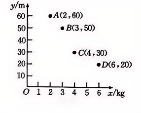

# Mathematics - 题目 2348

**ID**: ce9c5bb1c9a54e3cb2c1f3cdb14d78ce
**年级**: Grade 9
**难度**: Medium
**题型**: Calculation

## 题目
某科学兴趣小组成员为研究物体质量对物体弹射高度的影响，利用一款弹射器进行试验研究，弹射器将不同质量的小球从地面弹出，利用无人机技术测量每次试验小球弹射的最大高度，小组成员收集了小球弹射的最大高度 $y$ （单位： ${\rm{m}})$ 与小球质量 $x$ （单位： ${\rm{k}}{\rm{g}})$ 之间的关系，并绘制在平面直角坐标系中，如图所示.​​​​​​​‌（1）由图象可知 $y$ 与 $x$ 之间满足反比例函数关系，若有一个点的纵坐标记录错误，则这个点是点（填字母），正确的 $y$ 值应为.（2）求反比例函数的表达式（3）请通过计算判断质量为 $12{\rm{k}}{\rm{g}}$ 的小球能够弹射到12m的高度吗？

## 解答

1. 解：（1）B；40
2. （2）设 $y$ 关于 $x$ 的函数表达式为 $y=\frac {k}{x}(k\ne 0)$ ，
3. 将点 $(2,60)$ 代入上式，得 $60=\frac {k}{2}$ ，
4. 解得 $k=120$ ，
5. $\therefore y=\frac {120}{x}.$
6. （3）将 $x=12$ 代人 $y=\frac {120}{x}$ 中，得 $y=\frac {120}{12}=10$ ，
7. $\because 10<12,$
8. $\therefore $ 质量为 $12{\rm{k}}{\rm{g}}$ 的小球不能弹射到 $12{\rm{m}}$ 的高度.

## 知识点

**中文**:
  - 反比例函数的应用

**English**:
  - Applications of Inverse Proportionality

---
