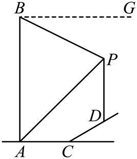

# Mathematics - 题目 400

**ID**: d320ab48875a4123ab585317491d2819
**年级**: Grade 9
**难度**: Medium
**题型**: Calculation

## 题目
为了节约碳资源，国家开发了风电项目．某电力部门在一处坡度 $i=1:\sqrt {3}$ 的坡地上安装了几架风力发电机，在风力发电机组中，“风电塔筒”的高度是一个重要的设计参数．某数学兴趣小组成员开展了“测量风电塔筒高度”的实践活动．如图，已知斜坡 $CD$ 长为20米，在地面点 $\mathrm{A}$ 处测得风力发电机塔筒顶端 $P$ 点的仰角为 $45{}\degree $ ，利用无人机在点 $\mathrm{A}$ 的正上方62米的点 $B$ 处，测得 $P$ 点的俯角为 $26.​​​​​​​‌6{}\degree $ ，求该风力发电机塔筒 $PD$ 的高度．（结果精确到0.1米，参考数据： $\sin 26.6{}\degree \approx 0.45$ ， ${\cos}26.6{}\degree \approx 0.89$ ， ${\tan}26.6\mathrm{°}\approx 0.5$ ）

## 解答

1. 解：延长 $PD$ 交 $AC$ 于点 $F$ ，延长 $DP$ 交 $BG$ 于点 $E$ ，如图所示：
2. 
3. 由题意得 $PF\bot AF$ ， $DE\bot BG$ ， $AB\bot AF$ ，
4. $\therefore $ 四边形 $ABEF$ 为矩形，
5. $\therefore AB=EF=62$ 米， $AF=BE$ ，
6. 设 $AF=BE=x$ 米，
7. 在 ${\rm{R}}{\rm{t}}\mathrm{△}CDF$ 中， $i=1:\sqrt {3}$
8. $\therefore \angle DCF=30{}\degree $ ，
9. $\because CD=20$ 米，
10. $\therefore DF=\frac {1}{2}CD=10$ 米，
11. 在 ${\rm{R}}{\rm{t}}△PAF$ 中， $\angle PAF=45{}\degree $ ，
12. $\therefore PF=AF\cdot {\rm{t}}{\rm{a}}{\rm{n}}45{}\degree =x$ 米，
13. 在 ${\rm{R}}{\rm{t}}\mathrm{△}BPE$ 中， $\angle EBP=26.6{}\degree $ ，
14. $\therefore EP=BE\cdot {\rm{t}}{\rm{a}}{\rm{n}}26.6{}\degree \approx 0.5x$ 米，
15. $\therefore EF=PF+PE=x+0.5x=1.5x$ 米，
16. $\therefore 1.5x=62$ ，解得 $x\approx 41.3$ ，
17. $\therefore PF=41.3$ 米，
18. $\therefore PD=PF-DF=41.3-10=31.3$ 米，
19. $\therefore $ 该风力发电机塔杆 $PD$ 的高度约为31.3米．

## 知识点

**中文**:
  - 解直角三角形
  - 解直角三角形的实际应用

**English**:
  - Solving Right Triangles
  - Applications of Solving Right Triangles

---
