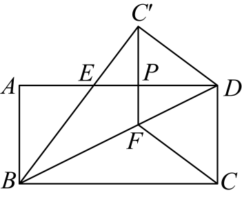

# Mathematics - 题目 1586

**ID**: d3a6e9edec22481999e3c8dba1b73d55
**年级**: Grade 9
**难度**: Medium
**题型**: Calculation

## 题目
如图，将矩形 $ABCD$ 沿对角线 $BD$ 翻折，点C落在 $C^{′}$ 处， $BC^{′}$ 交 $AD$ 于点E．过点 $C^{′}$ 作 $C^{′}F\mathrm{/\mskip-4mu/}CD$ ，交 $AD$ ， $BD$ 分别于点P，F，连接 $CF$ ．(1)求证：四边形 $C^{′}FCD$ 是菱形；​​​​​​​‌(2)若 $CD=4{\rm{，}}BC=8$ ，求线段 $C{^{\prime }}P$ 的长．

## 解答

1. （1）证明：∵ 矩形 $ABCD$ 沿对角线 $BD$ 翻折，点C落在 $C^{′}$ 处， $BC^{′}$ 交 $AD$ 于点E，
2. ∴ $DC=DC^{′},\angle FDC=\angle FDC^{′}$ ， $FC=FC^{′}$ ，
3. ∵ $C^{′}F\mathrm{/\mskip-4mu/}CD$ ，
4. ∴ $\angle C^{′}FD=\angle FDC$ ，
5. ∴ $C^{′}F=DC^{′}$ ，
6. ∴ $C^{′}F=DC^{′}=DC=FC$ ，
7. ∴四边形 $C^{′}FCD$ 是菱形．
8. （2）解：∵ 矩形 $ABCD$ ， $CD=4{\rm{，}}BC=8$ ，
9. ∴ $\angle ADC=\angle BAD=90{}\degree $ ， $AB=CD=4,AD=BC=8$ ，
10. ∴ ${\tan}\angle ADB=\frac {AB}{AD}=\frac {1}{2}$ ；
11. ∵ $C^{′}F\mathrm{/\mskip-4mu/}CD$ ，
12. ∴ $\angle APF=\angle ADC=\angle DPF=90{}\degree $ ，
13. ∴ ${\tan}\angle ADB=\frac {PF}{PD}=\frac {1}{2}$ ；
14. 设 $PF=x$ ，
15. 则 $PD=2x$ ，
16. 根据四边形 $C^{′}FCD$ 是菱形，
17. ∴ $C^{′}F=DC^{′}=DC=FC=4$ ，
18. ∴ $C^{′}P=C^{′}F-PF=4-x$ ，
19. 根据勾股定理，得 ${\left({4-x}\right)^{2}}+4x{^{2}}=16$ ，
20. 解得 $x=\frac {8}{5},x=0$ （舍去）．
21. ∴ $C^{′}P=4-x=\frac {12}{5}$ ．

## 知识点

**中文**:
  - 折叠问题
  - 菱形的判定
  - 矩形的性质
  - 解直角三角形

**English**:
  - Folding Problems
  - Determination of Rhombuses
  - Properties of Rectangles
  - Solving Right Triangles

---
