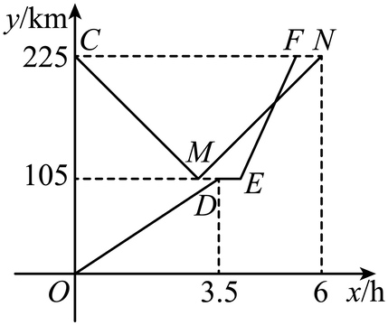

# Mathematics - 题目 1481

**ID**: d83b6d1d86f14540ab0244f11add38db
**年级**: Grade 9
**难度**: Medium
**题型**: Calculation

## 题目
甲、乙两货车分别从相距 $225\mathrm{k}\mathrm{m}$ 的 ${\rm \mathit{A},\mathit{B}}$ 两地同时出发，甲货车从 ${\rm \mathit{A}}$ 地出发途经配货站时，停下来卸货，半小时后继续驶往 ${\rm \mathit{B}}$ 地，乙货车沿同一条公路从 ${\rm \mathit{B}}$ 地驶往 ${\rm \mathit{A}}$ 地，但乙货车到达配货站时接到紧急任务立即原路原速返回 ${\rm \mathit{B}}$ 地，结果比甲货车晚半小时到达 ${\rm \mathit{B}}$ 地．如图是甲、乙两货车距 ${\rm \mathit{A}}$ 地的距离 $y\left ({{\rm{k}}{\rm{m}}}\right )$ 与行驶时间 $x\left ({{\rm{h}}}\right )$ 之间的函数图象，结合图象回答下列问题.​​​​​​​‌(1)甲货车到达配货站之前的速度是${\rm{k}}{\rm{m}}{\rm{/}}{\rm{h}}$ ，乙货车的速度是${\rm{k}}{\rm{m}}{\rm{/}}{\rm{h}}$ ；(2)求甲货车在配货站卸货后驶往 ${\rm \mathit{B}}$ 地的过程中，甲货车距 ${\rm \mathit{A}}$ 地的距离 $y\left ({{\rm{k}}{\rm{m}}}\right )$ 与行驶时间 $x\left ({{\rm{h}}}\right )$ 之间的函数解析式；(3)直接写出甲、乙两货车在行驶的过程中，出发多长时间甲、乙两货车与配货站的距离相等．

## 解答

1. （1）解：由图象可知甲货车到达配货站路程为105km，所用时间为3.5h，
2. 则甲货车到达配货站之前的速度是 $105\div 3{{.}}5{\rm{=}}30$ （ ${\rm{k}}{\rm{m}}{\rm{/}}{\rm{h}}$ ）,
3. 乙货车到达配货站路程为 $225-105{\rm{=}}120({\rm{k}}{\rm{m}}{\rm{)}}$ ，到达配货站时接到紧急任务立即原路原速返回 ${\rm \mathit{B}}$ 地，总路程为240km，总时间是6h，
4. ∴乙货车速度 $=240\div 6=40\left ({{\rm{k}}{\rm{m}}/{\rm{h}}}\right )$ .
5. （2）甲货车从 ${\rm \mathit{A}}$ 地出发途经配货站时，停下来卸货，半小时后继续驶往 ${\rm \mathit{B}}$ 地，由图象可知 $E(4,105)$ 和点 $F(5.5,225)$
6. 设 $y{{}_{EF}}=kx+b(4\leqslant x\leqslant 5.5)$ ，∴ $\begin{cases}4k+b=105\\5.5k+b=225\end{cases}$ ，解得 $\begin{cases}b=-215\\k=80\end{cases}$ ，
7. ∴甲货车距 ${\rm \mathit{A}}$ 地的距离 $y\left ({{\rm{k}}{\rm{m}}}\right )$ 与行驶时间 $x\left ({{\rm{h}}}\right )$ 之间的函数解析式 $y=80x-215\left ({4\leqslant x\leqslant 5.5}\right )$ .
8. （3）设甲货车出发 $x{\rm{h}}$ ，甲、乙两货车与配货站的距离相等，
9. ①两车到达配货站之前： $105-30x=120-40x$ ，解得 $x=1.5$ ,
10. ②乙货车到达配货站时开始返回，甲货车未到达配货站： $105-30x=40x-120$ ，
11. 解得 $x=\frac {45}{14}$ ，
12. ③甲货车在配货站卸货后驶往 ${\rm \mathit{B}}$ 地时 $80x-215-105=40x-120$ ，解得 $x=5$ ，
13. 答：经过 $1.5{\rm{h}}$ 或 $\frac {45}{14}{\rm{h}}$ 或 $5{\rm{h}}$ ,甲、乙两货车与配货站的距离相等．

## 知识点

**中文**:
  - 从函数的图象获取信息
  - 行程问题
  - 待定系数法求一次函数解析式

**English**:
  - Extracting Information from Graphs
  - Distance-Speed-Time Problems
  - Finding Expressions by Undetermined Coefficients

---
