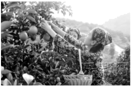
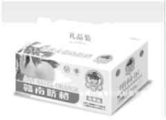

# Mathematics - 题目 3533

**ID**: d89fe7b1b2614cce8c9524a44380aa4f
**年级**: Grade 9
**难度**: Medium
**题型**: Calculation

## 题目
赣南脐橙果大形正，肉质脆嫩，风味浓甜芳香，深受大家的喜爱.​​​​​​​‌某脐橙生产基地生产的礼品盒包装的脐橙每箱的成本为30元，按定价50元出售，每天可销售200箱.为了增加销量，该生产基地决定采取降价措施，经市场调研，每降价1元，日销售量可增加20箱.（1）求出每天销售量y（箱）与销售单价x（元）之间的函数关系式；（2）若该生产基地每天要实现最大销售利润，每箱礼品盒包装的脐橙应定价多少元？每天可实现的最大利润是多少?

## 解答

1. 解：（1）由题意得 $y=200+20\left ({50-x}\right )=-20x+1200$ ，
2. $\therefore y$ 与x之间的函数关系式为 $y=-20x+1200$ ；
3. （2）设每天销售利润为w元，
4. 据题意，得 $w=\left ({x-30}\right )y=\left ({x-30}\right )\left ({-20x+1200}\right )$ ，
5. 整理得 $w=-20x{^{2}}+1800x-36000=-20{\left({x-45}\right)^{2}}+4500$ ，
6. ∴当 $x=45$ 时，销售利润最大，此时 $w=4500$ 元.
7. 答：当每箱礼品盒包装的脐橙定价为45元时，每天可实现的最大利润为4500元.

## 知识点

**中文**:
  - 销售问题

**English**:
  - Sales Problems

---
