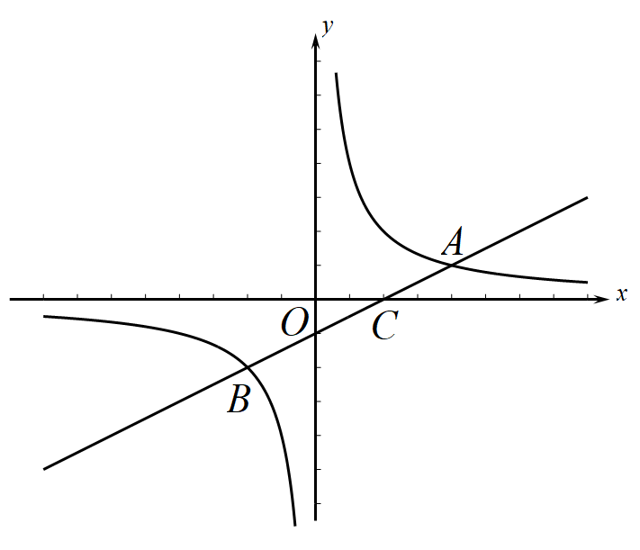

# Mathematics - 题目 429

**ID**: d9991073d5664cd9b1a0e8df5e321c2f
**年级**: Grade 9
**难度**: Medium
**题型**: Calculation

## 题目
如图，一次函数 $y=\frac {1}{2}x-1$ 的图象与反比例函数 $y=\frac {k}{x}\left ({k\ne 0}\right )$ 的图象交于 $A\left ({a,1}\right ),B\left ({-2,b}\right )$ 两点，与x轴相交于点C．(1)求反比例函数的表达式；​​​​​​​‌(2)观察图象，直接写出不等式 $\frac {1}{2}x-1\leqslant \frac {k}{x}$ 的解集；(3)若点P为x轴上的一动点，连接 $AP,BP$ ，当 $△APB$ 的面积为 $\frac {5}{2}$ 时，求点P的坐标．

## 解答

1. （1）解： $\because $ 函数 $y=\frac {1}{2}x-1$ 的图象经过 $A\left ({a,1}\right )$ ，
2. $\therefore 1=\frac {1}{2}a-1$ ，解得： $a=4$ ，
3. $\therefore A\left ({4,1}\right )$ ，
4. $\therefore k=1\times 4=4$ ，
5. $\therefore $ 反比例函数表达式为： $y=\frac {4}{x}$ ；
6. （2）解： $\because $ 函数 $y=\frac {1}{2}x-1$ 的图象经过 $B\left ({-2,b}\right )$ ，
7. $\therefore b=\frac {1}{2}\times \left ({-2}\right )-1=-2$ ，
8. $\therefore B\left ({-2,-2}\right )$ ，
9. $\therefore $ 由图可得，不等式 $\frac {1}{2}x-1\leqslant \frac {k}{x}$ 的解集是： $x\leqslant -{{2}}$ 或 $0<x\leqslant 4$ ；
10. （3）解：如下图，
11. 
12. 设 $P\left ({m,0}\right )$ ，
13. 在 $y=\frac {1}{2}x-1$ 中， 当 $y=0$ 时，得 $\frac {1}{2}x-1=0$ ，
14. 解得： $x=2$ ，
15. $\therefore C\left ({2,0}\right )$ ，
16. $\therefore PC=\left |{m-2}\right |$ ，
17. ∴ $S{{}_{\vartriangle APB}}=S{{}_{\vartriangle APC}}+S{{}_{\vartriangle BPC}}=\frac {1}{2}\times 1\times \left |{m-2}\right |+\frac {1}{2}\times 2\times \left |{m-2}\right |=\frac {5}{2}$ ，
18. 整理得： $\left |{m-2}\right |=\frac {5}{3}$ ，
19. 解得： $m=\frac {1}{3}$ 或 $\frac {11}{3}$ ．
20. ∴ $P\left ({\frac {1}{3},0}\right )$ 或 $\left ({\frac {11}{3},0}\right )$ ．

## 知识点

**中文**:
  - 一次函数的图象和性质
  - 反比例函数综合

**English**:
  - Graphs and Properties of Linear Functions
  - Comprehensive Inverse Proportionality Problems

---
