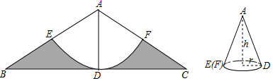

# Mathematics - 题目 1953

**ID**: da817ce3dc874eddb9a90b39694092c8
**年级**: Grade 9
**难度**: Medium
**题型**: Calculation

## 题目
如图，在等腰 $\vartriangle ABC$ 中， $\angle BAC=120{}^\circ $ ，AD是 $\angle BAC$ 的角平分线，且 $AD=6$ ，以点A为圆心，AD长为半径画弧EF，交AB于点E，交AC于点F，（1）求由弧EF及线段FC、CB、BE围成图形（图中阴影部分）的面积；​​​​​​​‌（2）将阴影部分剪掉，余下扇形AEF，将扇形AEF围成一个圆锥的侧面，AE与AF正好重合，圆锥侧面无重叠，求这个圆锥的高h．

## 解答

1. ∵在等腰 $\vartriangle {\rm{A}}{\rm{B}}{\rm{C}}$ 中， $∠{\rm{B}}{\rm{A}}{\rm{C}}=120{}^\circ $ ，
2. ∴ $∠{\rm{B}}=30{}^\circ $ ，
3. ∵AD是 $∠{\rm{B}}{\rm{A}}{\rm{C}}$ 的角平分线，
4. ∴ ${\rm{A}}{\rm{D}}\bot {\rm{B}}{\rm{C}}$ ， ${\rm{B}}{\rm{D}}={\rm{C}}{\rm{D}}$ ，
5. ∴ ${\rm{B}}{\rm{D}}=\sqrt {3}{\rm{A}}{\rm{D}}=6\sqrt {3}$ ，
6. ∴ ${\rm{B}}{\rm{C}}=2{\rm{B}}{\rm{D}}=12\sqrt {3}$ ，
7. ∴由弧EF及线段FC、CB、BE围成图形（图中阴影部分）的面积 ${\rm{=}}{\rm{S}}{{}_{\vartriangle {\rm{A}}{\rm{B}}{\rm{C}}}}-{\rm{S}}{{}_{扇形{\rm{E}}{\rm{A}}{\rm{F}}}}=\frac {1}{2}\times 6\times 12\sqrt {3}-\frac {120\cdot {\rm{π}}\cdot 6{^{2}}}{360}=36\sqrt {3}-12{\rm{π}}$ .
8. （2）设圆锥的底面圆的半径为r，
9. 根据题意得 $2{\rm{π}}{\rm{r}}=\frac {120\cdot {\rm{π}}\cdot 6}{180}$ ，解得 ${\rm{r}}=2$ ，
10. 这个圆锥的高 ${\rm{h}}=\sqrt {6{^{2}}-2{^{2}}}=4\sqrt {2}$ ．

## 知识点

**中文**:
  - 扇形面积的计算

**English**:
  - Sector Area Calculation

---
