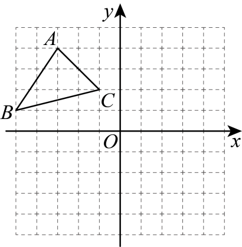

# Mathematics - 题目 3504

**ID**: db41933d314848ebac3cbef1d928adb7
**年级**: Grade 9
**难度**: Medium
**题型**: Calculation

## 题目
如图，方格纸中每个小正方形的边长都是单位 ${\rm 1，}\vartriangle ABC$ 的三个顶点都在格点上，结合所给的平面直角坐标系解答下列问题：(1)作出 $\vartriangle ABC$ 关于x轴对称的 $\mathrm{△}A{{}_{1}}B{{}_{1}}C{{}_{1}}$ ；​​​​​​​‌(2)将 $\mathrm{△}A{{}_{1}}B{{}_{1}}C{{}_{1}}$ 绕O点逆时针旋转 $90{}\degree $ ，画出旋转后的 $\mathrm{△}A{{}_{2}}B{{}_{2}}C{{}_{2}}$ ．(3)在（2）的条件下，求点 $A{{}_{1}}$ 旋转到 $A{{}_{2}}$ 所经过的路径长？

## 解答

1. （1）如图， $\mathrm{△}A{{}_{1}}B{{}_{1}}C{{}_{1}}$ 即为所求，
2. 
3. （2）解：如上图， $\mathrm{△}A{{}_{2}}B{{}_{2}}C{{}_{2}}$ 即为所求
4. （3）解：由网格可得： $OA{{}_{1}}=\sqrt {3{^{2}}+4{^{2}}}=5$ ，
5. ∵将 $\mathrm{△}A{{}_{1}}B{{}_{1}}C{{}_{1}}$ 绕O点逆时针旋转 $90{}\degree $ ，
6. ∴点 $A{{}_{1}}$ 旋转到 $A{{}_{2}}$ 所经过的路径长为 $\frac {90\times π\times 5}{180}=\frac {5π}{2}$ ．

## 知识点

**中文**:
  - 弧长公式
  - 画轴对称图形
  - 画旋转图形

**English**:
  - Arc Length Formula
  - Drawing Axially Symmetric Figures
  - Drawing Rotated Figures

---
