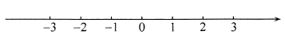

# Mathematics - 题目 3284

**ID**: df3ab3a966dd43d495720f61bb8cdd06
**年级**: Grade 9
**难度**: Medium
**题型**: Calculation

## 题目
解不等式组 $\begin{cases}2x-2\leqslant 0①\\2x-1<3x②\end{cases}$请结合题意填空，完成本题的解答（1）解不等式①，得；​​​​​​​‌（2）解不等式②，得；（3）把不等式①和②的解集在数轴上表示出来：（4）原不等式组的解集为．

## 解答

1. （1）移项，得 $2x\leqslant 2$
2. 系数化为1，得 $x\leqslant 1$
3. 故答案为： $x\leqslant 1$ ；
4. （2）移项，得 $2x-3x<1$
5. 合并同类项，得 $-x<1$
6. 系数化为1，得 $x>-1$
7. 故答案为： $x>-1$ ；
8. （3）把不等式①和②的解集在数轴上表示出来如下所示：
9. 
10. （4）找出（3）中的公共部分得：原不等式组的解集为 $-1<x\leqslant 1$
11. 故答案为： $-1<x\leqslant 1$ ．

## 知识点

**中文**:
  - 在数轴上表示不等式的解集
  - 解一元一次不等式组

**English**:
  - Representing Solution Sets on Number Line
  - Solving Systems of Inequalities

---
