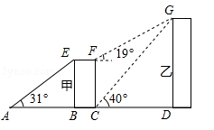

# Mathematics - 题目 3711

**ID**: e163da511c7d4eef9ce830d31e4a10d8
**年级**: Grade 9
**难度**: Medium
**题型**: Calculation

## 题目
某学校教学楼（甲楼）的顶部E和大门A之间挂了一些彩旗．小颖测得大门A距甲楼的距离AB是31cm，在A处测得甲楼顶部E处的仰角是31°．（1）求甲楼的高度及彩旗的长度；（精确到0.​​​​​​​‌01m）（2）若小颖在甲楼楼底C处测得学校后面医院楼（乙楼）楼顶G处的仰角为40°，爬到甲楼楼顶F处测得乙楼楼顶G处的仰角为19°，求乙楼的高度及甲乙两楼之间的距离．（精确到0.01m）（cos31°≈0.86，tan31°≈0.60，cos19°≈0.95，tan19°≈0.34，cos40°≈0.77，tan40°≈0.84）

## 解答

1. 试题分析：（1）在直角三角形ABE中，利用锐角三角函数定义求出AE与BE的长即可；
2. （2）过点F作FM⊥GD，交GD于M，在直角三角形GMF中，利用锐角三角函数定义表示出GM与GD，设甲乙两楼之间的距离为xm，根据题意列出方程，求出方程的解即可得到结果．
3. 试题解析：解：（1）在Rt△ABE中，BE=AB•tan31°=31tan31°≈18.60，AE= $\frac {AB}{{\cos}31{^{\circ }}}$  = $\frac {31}{{\cos}31{^{\circ }}}$ ≈36.05，则甲楼的高度为18.60m，彩旗的长度为36.05m；
4. （2）过点F作FM⊥GD，交GD于M，在Rt△GMF中，GM=FM•tan19°，在Rt△GDC中，DG=CD•tan40°，设甲乙两楼之间的距离为xm，FM=CD=x，根据题意得：xtan40°﹣xtan19°=18.60，解得：x=37.20，则乙楼的高度为31.25m，甲乙两楼之间的距离为37.20m．

## 知识点

**中文**:
  - 解直角三角形的实际应用

**English**:
  - Applications of Solving Right Triangles

---
