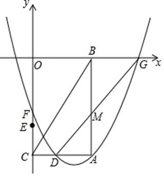

# Mathematics - 题目 2494

**ID**: e8119e4b0df34f5e8e40288fdfc43005
**年级**: Grade 9
**难度**: Medium
**题型**: Calculation

## 题目
如图，在平面直角坐标系中，点A的坐标为（6， $-6\sqrt {3}$ ），AB⊥x轴于点B，AC⊥y轴于点C，连接BC．点D是线段AC的中点，点E的坐标为（0， $-4\sqrt {3}$ ），点F是线段EO上的一个动点．过点A，D，F的抛物线与x轴正半轴交于点G，连接DG交线段AB于点M．(1)求∠ACB的度数；​​​​​​​‌(2)当点F运动到原点时，求过A，D，F三点的抛物线的函数表达式及点G的坐标；(3)以线段DM为一边作等边三角形DMP，点P与点A在直线DG同侧，当点F从点E运动到点O时，请直接写出点P运动的路径的长．

## 解答

1. 解：（1）∵点A的坐标为 $\left ({6，-6\sqrt {3}}\right )$ ，AB⊥x轴于点B，
2. ∴B（6，0），
3. ∴AB＝ $6\sqrt {3}$ ，
4. ∵点A的坐标为 $\left ({6，-6\sqrt {3}}\right )$ ，AC⊥y轴于点C，
5. ∴C（0， $-6\sqrt {3}$ ），
6. ∴AC＝6，
7. ∵AB⊥x轴，AC⊥y轴，
8. ∴∠ABO＝∠ACO＝90°＝∠BOC，
9. ∴四边形OBAC是矩形，
10. ∴∠BAC＝90°，
11. 在Rt△ABC中，tan∠ACB＝ $\frac {AB}{AC}=\frac {6\sqrt {3}}{6}=\sqrt {3}$ ，
12. ∴∠ACB＝60°；
13. （2）由（1）知，C（0， $-6\sqrt {3}$ ），
14. ∵点D是AC的中点，
15. ∴D（3， $-6\sqrt {3}$ ），
16. 设抛物线的解析式为y＝ax^{2}+bx+c，
17. 将点A（6， $-6\sqrt {3}$ ），D（3， $-6\sqrt {3}$ ），O（0，0）代入抛物线解析式中，得 $\begin{cases}36a+6b+c=-6\sqrt {3}\\9a+3b+c=-6\sqrt {3}\\c=0\end{cases}$ ，
18. ∴ $\begin{cases}a=\frac {\sqrt {3}}{3}\\b=-3\sqrt {3}\\c=0\end{cases}$ ，
19. ∴抛物线的解析式为 $y=\frac {\sqrt {3}}{3}x{^{2}}-3\sqrt {3}x$ ，
20. 令y＝0，则 $\frac {\sqrt {3}}{3}x{^{2}}-3\sqrt {3}x=0$ ，
21. ∴x＝0或x＝9，
22. ∴G（9，0）；
23. （3）如图，
24. 当点F从点E运动到点O时，点M的运动轨迹是线段MM'，
25. ∴以DM为边的等边三角形的顶点P的轨迹是线段PP'，
26. 当抛物线过原点时，DG与AB的交点记作点M，当抛物线过点E时，DG'与AB的交点为M'，
27. ∵△DMP是等边三角形，
28. ∴DM＝DP，∠MDP＝60°，
29. ∵△DM'P'是等边三角形
30. ∴DM'＝DP'，∠M'DP'＝60°，
31. ∴∠MDM'＝∠PDP'，
32. ∴△MDM'≌△PDP'（SAS），
33. ∴PP'＝MM'，
34. 由（2）知，G（9，0），
35. ∵D（3， $-6\sqrt {3}$ ），
36. ∴直线DG的解析式 $y=\sqrt {3}x-9\sqrt {3}$ ，
37. 令x＝6，则y＝ $-3\sqrt {3}$ ，
38. ∴M$\left ({6，-3\sqrt {3}}\right )$ ，
39. 当抛物线过点E时，即抛物线过点A，D，E，
40. 设抛物线的解析式为 $y=a^{′}x{^{2}}+b^{′}x+c^{′}$ ，
41. ∴ $\begin{cases}36a^{′}+6b^{′}+c^{′}=-6\sqrt {3}\\9a^{′}+3b^{′}+c^{′}=-6\sqrt {3}\\c^{′}=-4\sqrt {3}\end{cases}$ ，
42. ∴ $\begin{cases}a^{′}=\frac {\sqrt {3}}{9}\\b^{′}=-\sqrt {3}\\c^{′}=-4\sqrt {3}\end{cases}$ ，
43. ∴过点A，D，E的抛物线的解析式为 $y=\frac {\sqrt {3}}{9}x{^{2}}-\sqrt {3}x-4\sqrt {3}$ ，
44. 令y＝0，则 $0=\frac {\sqrt {3}}{9}x{^{2}}-\sqrt {3}x-4\sqrt {3}$ ，
45. ∴x＝﹣3或x＝12，
46. ∴G'（12，0），
47. ∴DG'的解析式为 $y=\frac {2\sqrt {3}}{3}x-8\sqrt {3}$ ，
48. 令x＝6，则y＝ $-4\sqrt {3}$ ，
49. ∴M'（6， $-4\sqrt {3}$ ），
50. ∴PP'＝MM'＝ $-3\sqrt {3}-\left ({-4\sqrt {3}}\right )=\sqrt {3}$ ，
51. 即点P运动的路径的长为 $\sqrt {3}$ ．
52. 

## 知识点

**中文**:
  - 二次函数的综合

**English**:
  - Comprehensive Quadratic Function Problems

---
