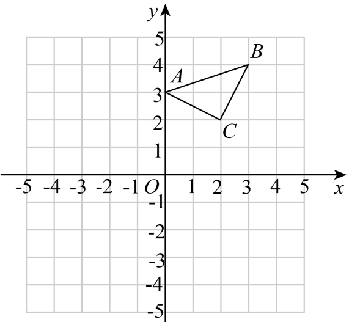

# Mathematics - 题目 1888

**ID**: e92d8d4ac55a48168a44c650bb4efcbc
**年级**: Grade 9
**难度**: Medium
**题型**: Calculation

## 题目
如图，在直角坐标系中， $\vartriangle ABC$ 三个顶点的坐标分别为 $A\left ({0,3}\right )$ ， $B\left ({3,4}\right )$ ， $C\left ({2,2}\right )$ ．(1)直接写出 $\vartriangle ABC$ 关于原点O的中心对称图形 $\mathrm{△}A{{}_{1}}B{{}_{1}}C{{}_{1}}$ 的对称点 $A{{}_{1}}、B{{}_{1}}、C{{}_{1}}$ 的坐标；​​​​​​​‌(2)画出 $\vartriangle ABC$ 关于原点O的中心对称图形 $\mathrm{△}A{{}_{1}}B{{}_{1}}C{{}_{1}}$ ；(3)求 $\mathrm{△}A{{}_{1}}B{{}_{1}}C{{}_{1}}$ 的面积．

## 解答

1. （1）解：∵ $A\left ({0,3}\right )$ ， $B\left ({3,4}\right )$ ， $C\left ({2,2}\right )$ ，
2. ∴ $A{{}_{1}}\left ({0,-3}\right )$ ， $B{{}_{1}}\left ({-3,-4}\right )$ ， $C{{}_{1}}\left ({-2,-2}\right )$ ；
3. （2）解：如图， $\mathrm{△}A{{}_{1}}B{{}_{1}}C{{}_{1}}$ 即为所求，
4. 
5. （3）解： $\mathrm{△}A{{}_{1}}B{{}_{1}}C{{}_{1}}$ 的面积为 $2\times 3-\frac {1}{2}\times 2\times 1-\frac {1}{2}\times 2\times 1-\frac {1}{2}\times 3\times 1=\frac {5}{2}$ ．

## 知识点

**中文**:
  - 中心对称——作图
  - 中心对称图形

**English**:
  - Construction: Central Symmetry
  - Centrally Symmetric Figures

---
