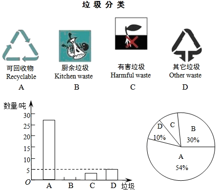

# Mathematics - 题目 2668

**ID**: e9b91528a3f240dda8700a05cf388200
**年级**: Grade 9
**难度**: Medium
**题型**: Calculation

## 题目
垃圾的分类处理与回收利用，可以减少污染，节省资源．深圳市环境卫生局为了提高宣传实效，抽样调查了部分居民小区一段时间内生活垃圾的分类情况，其相关信息如下：根据图表解答下列问题：（1）请将条形统计图补充完整；（2）在扇形统计图中，产生的有害垃圾C所对应的圆心角为度；（3）调查发现，在可回收物中塑料类垃圾占13%，每回收1吨塑料类垃圾可获得0.​​​​​​​‌5吨二级原料．假设深圳市每天产生的生活垃圾为28500吨，且全部分类处理，那么每天回收的塑料类垃圾可以获得多少吨二级原料？

## 解答

1. 解：（1）本次调查的吨数为：5÷10%＝50，
2. B类有50×30%＝15（吨），
3. 补全的条形统计图如右图所示；
4. （2）在扇形统计图中，产生的有害垃圾C所对应的圆心角为：360°×（1﹣54%﹣30%﹣10%）＝21.6°，
5. 故答案为：21.6；
6. （3）28500×54%×13%×0.5＝1000.35（吨），
7. 答：每天回收的塑料类垃圾可以获得1000.35吨二级原料．
8. 

## 知识点

**中文**:
  - 扇形统计图
  - 用样本估计总体
  - 条形统计图

**English**:
  - Pie Charts
  - Estimating Population from Sample
  - Bar Charts

---
