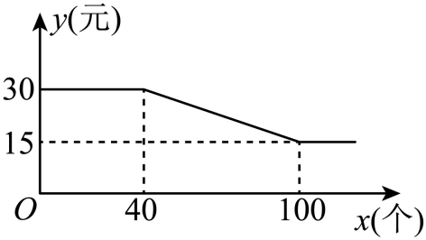

# Mathematics - 题目 3816

**ID**: edf4d9de22e047799d6a26618bdf1149
**年级**: Grade 9
**难度**: Medium
**题型**: Calculation

## 题目
这个冬天，“哈尔滨”爆火的背后，除了回忆青春的热情高涨，还有网友们的推波助澜，更离不开文旅产品的推动．某文创公司生产甲、乙两种产品共360个，其中甲产品的制作费y（元）与产量x（个）的函数图像如图中实线所示，乙产品的制作费始终为15元/个．(1)当 $40\leqslant x\leqslant 100$ 时，求y与x的函数表达式；​​​​​​​‌(2)若甲产品的生产数量不少于30个，且乙产品的生产数量不低于甲产品生产数量的3倍，如何分配甲，乙两产品的生产数量，才能使该文创公司的总制作费最低？

## 解答

1. （1）设y与x的函数表达式为 $y=kx+b$ ，
2. 把 $\left ({40,30}\right )$  ， $\left ({100,15}\right )$ 代入，
3. 得， $\begin{cases}40k+b=30\\100k+b=15\end{cases}$ ，
4. $\begin{cases}k=-\frac {1}{4}\\b=40\end{cases}$ ，
5. ∴ $y=-\frac {1}{4}x+40$ ； $\qquad $
6. （2）设总制作费为 $W$ 元，
7. 由题知： $x\geqslant 30$ ， $360-x\geqslant 3x$ ，
8. ∴ $30\leqslant x\leqslant 90$
9. ①当 $30\leqslant x\leqslant 40$ 时，
10. $W=30x+15(360-x)=15x+5400$ ，
11. ∵ $15>0$ ，
12. ∴W随x的增大而增大，
13. ∴当 $x=30$ 时， $W$ 最小，最小为 $15\times 30+5400=5850$ （元），
14. ②当 $40<x\leqslant 90$ 时，
15. $W=x\left ({-\frac {1}{4}x+40}\right )+15(360-x)=-\frac {1}{4}(x-50){^{2}}+6025$ ，
16. ∴对称轴为直线 $x=50$ ，
17. ∵ $-\frac {1}{4}<0$ ，  $x=40$ 与 $x=60$ 关于 $x=50$ 对称，当 $x>50$ 时，W随x的增大而减小，
18. ∴ $x=90$ 时， $W$ 取最小值，
19. 最小值为 $-\frac {1}{4}\times (90-50){^{2}}+6025=5625$ （元），
20. ∵ $5625\mathrm{<}5850$ ，
21. ∴当 $x=90$ 时， $W$ 取最小值，最小为5625元，
22. 此时 $360-x=270$ ，
23. 答：甲产品生产90个，乙产品生产270个，才能使文创公司的制作费最少，最少5625元．

## 知识点

**中文**:
  - 销售问题

**English**:
  - Sales Problems

---
