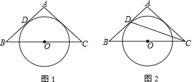

# Mathematics - 题目 90

**ID**: ee72454cce2e4fe48e859edc2be71a33
**年级**: Grade 9
**难度**: Medium
**题型**: Calculation

## 题目
如图1，△ABC是等腰三角形，O是底边BC中点，腰AB与⊙O相切于点D(1)求证：AC是⊙O的切线；​​​​​​​‌(2)如图2，连接CD，若tan∠BCD＝ $\frac {\sqrt {2}}{4}$ ，⊙O的半径为 $\sqrt {3}$ ，求BC的长．

## 解答

1. (1)证明：连接OD，OA，作OF⊥AC于F，如图，
2. 
3. ∵△ABC为等腰三角形，O是底边BC的中点，
4. ∴AO⊥BC，AO平分∠BAC，
5. ∵AB与⊙O相切于点D，
6. ∴OD⊥AB，
7. 而OF⊥AC，
8. ∴OF＝OD，
9. ∴AC是⊙O的切线；
10. (2)过D作DF⊥BC于F，连接OD，
11. ∵tan∠BCD＝ $\frac {\sqrt {2}}{4}$ ，
12. ∴ $\frac {DF}{CF}=\frac {\sqrt {2}}{4}$ ，
13. 设DF＝ $\sqrt {2}$ a，OF＝x，则CF＝4a，OC＝4a﹣x，
14. ∵O是底边BC中点，
15. ∴OB＝OC＝4a﹣x，
16. ∴BF＝OB﹣OF＝4a﹣2x，
17. ∵OD⊥AB，
18. ∴∠BDO＝90°，
19. ∴∠BDF+∠FDO＝90°，
20. ∵DF⊥BC，
21. ∴∠DFB＝∠OFD＝90°，∠FDO+∠DOF＝90°，
22. ∴∠BDF＝∠DOF，
23. ∴△DFO∽△BFD，
24. ∴ $\frac {BF}{DF}=\frac {DF}{FO}$ ，
25. ∴ $\frac {4a-2x}{\sqrt {2}a}=\frac {\sqrt {2}a}{x}$ ，
26. 解得：x_{1}＝x_{2}＝a，
27. ∵⊙O的半径为 $\sqrt {3}$ ，
28. ∴OD＝ $\sqrt {3}$ ，
29. ∵DF^{2}+FO^{2}＝DO^{2}，
30. ∴( $\sqrt {2}$ x)^{2}+x^{2}＝( $\sqrt {3}$ )^{2}，
31. ∴x_{1}＝x_{2}＝a＝1，
32. ∴OC＝4a﹣x＝3，
33. ∴BC＝2OC＝6．

## 知识点

**中文**:
  - 切线的性质和判定的综合应用
  - 等腰三角形的性质

**English**:
  - Tangent Applications
  - Properties of Isosceles Triangles

---
