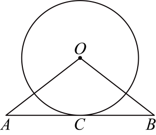

# Mathematics - 题目 2156

**ID**: efb24db5077c4433acfbd908d1c4a228
**年级**: Grade 9
**难度**: Medium
**题型**: Calculation

## 题目
如图，直线 $AB$ 经过 $\odot O$ 上的点C，并且 $OA=OB$ ， $CA=CB$ ．(1)求证：直线 $AB$ 是 $\odot O$ 的切线；​​​​​​​‌(2)若 $\odot O$ 的半径为 ${\rm 4，}AB=10$ ，求 $OA$ 的长．

## 解答

1. （1）证明：如图，连接 $OC$ ，
2. 
3. $\because OA=OB$ ， $CA=CB$ ，
4. $\therefore OC\bot AB$ ，
5. $\because OC$ 为 $\odot O$ 的半径，
6. $\therefore $ 直线 $AB$ 是 $\odot O$ 的切线．
7. （2）解： $\because AB=10$ ，
8. $\therefore CA=CB=\frac {1}{2}AB=\frac {1}{2}\times 10=5$ ，
9. $\because OC\bot AB$ ，
10. $\therefore \angle OCA=90{}\degree $ ，
11. $\therefore $ 在 ${\rm{R}}{\rm{t}}\vartriangle AOC$ 中，由勾股定理，得，
12. $OA=\sqrt {CA{^{2}}+OC{^{2}}}=\sqrt {5{^{2}}+4{^{2}}}=\sqrt {41}$ ．

## 知识点

**中文**:
  - 切线的判定定理
  - 勾股定理

**English**:
  - Tangent Determination Theorem
  - Pythagorean Theorem

---
