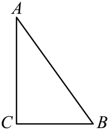

# Mathematics - 题目 1466

**ID**: f49f3e1314644ebc994d98d2ee465032
**年级**: Grade 9
**难度**: Medium
**题型**: Calculation

## 题目
如图在Rt△ABC中，∠C=90°，AC=8，AB=10．(1)用尺规作图作AB的垂直平分线EF，交AB于点E，交AC于点F（保留作图痕迹,不要求写作法）；​​​​​​​‌(2)在（1）的条件下，求EF的长度；

## 解答

1. （1）解：如图，分别以点A、B为圆心，以AB长为半径作弧交AB两侧于点M、N，连接MN交AB于E，交AC于F；
2. 
3. （2）解：∵ $\angle ACB=90{}^\circ $ ， $AC=8$ ， $AB=10$ ，
4. ∴ $BC=\sqrt {AB{^{2}}-AC{^{2}}}=\sqrt {10{^{2}}-8{^{2}}}=6$ ，
5. ∵ $EF$ 垂直平分线段 $AB$ ，
6. ∴ $AE=EB=5$ ，
7. ∵ $\angle A=\angle A$ ， $\angle AEF=\angle ACB=90{}^\circ $ ，
8. ∴ ${\rm{Δ}}AEF∽{\rm{Δ}}ACB$ ，
9. ∴ $\frac {AE}{AC}=\frac {EF}{CB}$ ，
10. ∴ $\frac {5}{8}=\frac {EF}{6}$ ，
11. ∴ $EF=\frac {15}{4}$ ．

## 知识点

**中文**:
  - 尺规作图——作线段垂直平分线
  - 相似三角形的判定与性质综合
  - 线段垂直平分线的性质

**English**:
  - Construction: Perpendicular Bisector
  - Determination and Properties
  - Properties of Perpendicular Bisectors

---
