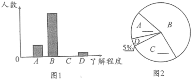

# Mathematics - 题目 766

**ID**: f959683df79d49af8ceda5a6ebf0bfb7
**年级**: Grade 9
**难度**: Medium
**题型**: Calculation

## 题目
某校为了解九年级学生对安徽省2020年中考新变化的了解情况，随机抽查了部分九年级学生（了解程度分为：“A：非常了解”、“B：比较了解”、“C：不太了解”、“D：完全不了解”，针对这个题目，问卷时要求每位被调查的学生必须从中选一项而且只能选一项），并将统计结果制成如下两幅不完整的统计图，图1中的 $A$ 、 $B$ 、 $D$ 的高度之比为 $3:11:1$ ，并且知道被调查的学生中非常了解和比较了解的共84人．请你根据以上提供的信息，解答下列问题．（1）被调查的学生中选“A：非常了解”的有人；​​​​​​​‌（2）一共调查了多少人？（3）若该校九年级有960名学生，请你估算该校九年级学生中对安徽省2020年中考新变化“不太了解”的有多少人？

## 解答

1. （1）设被调查的学生中选A的人数为 $3x$ 人，则选B的人数为 $11x$ 人，选D的人数为 $x$ 人
2. 由题意得： $3x+11x=84$
3. 解得 $x=6$
4. 则 $3x=18$
5. 即被调查的学生中选A的人数为18人
6. 故答案为：18；
7. （2）由（1）可知，选D的人数为6人
8. 则 $6\div 5\%=120$ （人）
9. 答：一共调查了120人；
10. （3）由（1）可知，选A、B、D的学生人数为 $3x+11x+x=15x=15\times 6=90$ （人）
11. 则选“C：不太了解”的学生人数占比为 $\frac {120-90}{120}\times 100\%=25\%$
12. $960\times 25\%=240$ （人）
13. 答：估计该校九年级学生中对安徽省2020年中考新变化“不太了解”的有240人．

## 知识点

**中文**:
  - 扇形统计图
  - 条形统计图

**English**:
  - Pie Charts
  - Bar Charts

---
