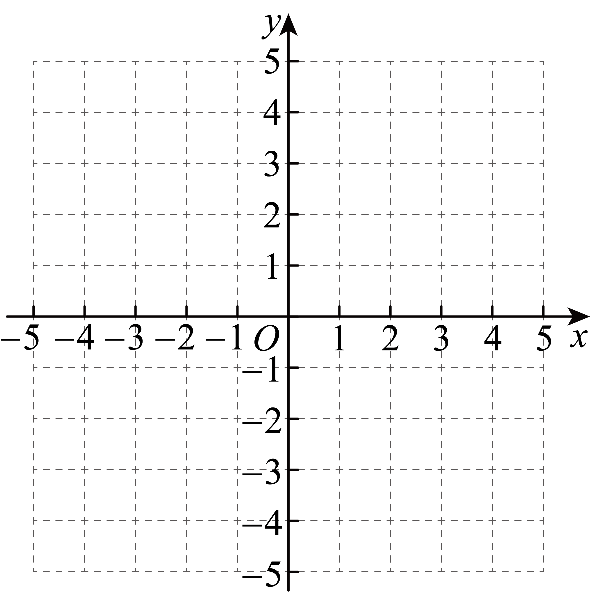

# Mathematics - 题目 832

**ID**: fdeea23bf3534f16b77714f781849b4d
**年级**: Grade 9
**难度**: Medium
**题型**: Calculation

## 题目
已知二次函数 $y{\rm{=}}x{^{{{2}}}}-{{2}}x-{{3}}$ ．（1）将 $y{\rm{=}}x{^{{{2}}}}-{{2}}x-{{3}}$ 化成 $y=a{\left({x-h}\right)^{2}}+k$ 的形式；​​​​​​​‌（2）在所给的平面直角坐标系中画出此函数的图象；（3）当 $-1<x<2$ 时，结合图象，直接写出函数值 $y$ 的取值范围．

## 解答

1. （1）解： $y{\rm{=}}x{^{{{2}}}}-{{2}}x-{{3}}$
2. $=\left ({x{^{2}}-2x+1}\right )-1-3$
3. $={\left({x-1}\right)^{2}}-4$ ；
4. （2）解：列表如下：
5. $x$
6. …
7. $-1$
8. 0
9. 1
10. 2
11. 3
12. …
13. $y{\rm{=}}x{^{{{2}}}}-{{2}}x-{{3}}$
14. …
15. 0
16. $-3$
17. $-4$
18. $-3$
19. 0
20. …
21. 函数图象如下所示：
22. 
23. （3）解：由函数图象可知，当 $-1<x<2$ 时，函数值 $y$ 的取值范围为 $-4\leqslant y<0$ ．

## 知识点

**中文**:
  - y=a（x-h）²+k的图象与性质
  - 用描点法画函数图象
  - 二次函数与不等式（组）

**English**:
  - Graph and Properties of y=a(x-h)²+k
  - Plotting Graphs by Points
  - Quadratic Functions and Inequalities

---
