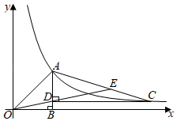

# Mathematics - 题目 446

**ID**: ff8812a14afa417b8fcfa71516985e2c
**年级**: Grade 9
**难度**: Medium
**题型**: Calculation

## 题目
如图，将 $\vartriangle ABO$ 放在平面直角坐标系中， $AB=OB=2$ ， $AB\bot OB$ ，反比例函数 $y=\frac {k}{x}$ 经过点A．在反比例函数的图像上取一点C，使得 $AC=2AO$ ，过点C作 $AB$ 的垂线，交 $AB$ 于点D，连接 $OD$ ，并延长 $OD$ 交 $AC$ 于点E．（1）求反比例函数的表达式；​​​​​​​‌（2）当点E刚好是 $AC$ 的中点时，求 $\angle DOB$ 的度数．

## 解答

1. 解：（1） $\because AB=OB=2$ ，
2. $\therefore A(2,2)$ ，
3. $\because $ 反比例函数 $y=\frac {k}{x}$ 过点 $A$ ，
4. $\therefore k=2\times 2=4$ ，
5. $\therefore $ 反比例函数的关系式为 $y=\frac {4}{x}$ ；
6. （2） $\because CD\bot AB$ ， $AB\bot OB$ ，
7. $\therefore CD//OB$ ，
8. 在 ${\rm{R}}{\rm{t}}\vartriangle ADC$ 中，点 $C$ 是 $AC$ 的中点，
9. $\therefore DE=AE=CE=\frac {1}{2}AC$ ，
10. $\because AC=2OA$ ，
11. $\therefore OA=AE$ ，
12. $\therefore \angle AOE=\angle AEO$ ， $\angle EDC=\angle ECD$ ，
13. $\therefore \angle AOE=\angle AEO=2\angle EDC=2\angle DOB$ ，
14. $\because \angle AOB=45{}^\circ $ ，
15. $\therefore \angle AOD+\angle DOB=45{}^\circ $
16. $\therefore \angle DOB=\frac {1}{3}\angle AOB=\frac {1}{3}\times 45{}^\circ =15{}^\circ $ ．

## 知识点

**中文**:
  - 反比例函数综合
  - 直角三角形斜边上的中线

**English**:
  - Comprehensive Inverse Proportionality Problems
  - Median to Hypotenuse of Right Triangle

---
