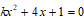

# Mathematics - 题目 3760

**ID**: 06dcc418e0ff4a91bcf82bdd5c200f6f
**年级**: Grade 9
**难度**: Medium
**题型**: Fill-in-the-blank

## 题目
关于的一元二次方程有两个不相等的实数根，则的取值范围是．​​​​​​​‌

## 解答

1. 解：根据题意得，k≠0且△＞0，
2. 即△=4^{2}-4k×1=16-4k＞0，
3. ∵原方程有两个不相等的实数根，
4. ∴k≠0且k＜4．
5. 故答案为：k≠0且k＜4．

## 知识点

**中文**:
  - 一元二次方程根的判别式

**English**:
  - Discriminant of Quadratic Equations

---
