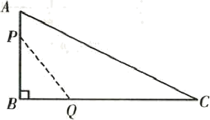

# Mathematics - 题目 874

**ID**: 09d948703bce4b509cc4a04ec34583b6
**年级**: Grade 9
**难度**: Medium
**题型**: Fill-in-the-blank

## 题目
如图，在 $ΔABC$ 中， $\angle B=90{}^\circ $ ， $AB=12$  ${\rm{m}}{\rm{m}}$ ， $BC=24$  ${\rm{m}}{\rm{m}}$ ，动点 $P$ 从点 $A$ 开始沿边 $AB$ 向 $B$ 以2 ${\rm{m}}{\rm{m}}{\rm{/}}{\rm{s}}$ 的速度移动（不与点 $B$ 重合），动点 $Q$ 从点 $B$ 开始沿边 $BC$ 向 $C$ 以4 ${\rm{m}}{\rm{m}}{\rm{/}}{\rm{s}}$ 的速度移动（不与点 $C$ 重合）.​​​​​​​‌如果 $P$ 、 $Q$ 分别从 $A$ 、 $B$ 同时出发，那么经过秒，四边形 $APQC$ 的面积最小.

## 解答

1. 解：设P、Q同时出发后经过的时间为ts，四边形APQC的面积为Scm^{2}，则有：
2. S=S△_{ABC}-S△_{PBQ}= $\frac {1}{2}$ ×12×6- $\frac {1}{2}$ （6-t）×2t
3. =t^{2}-6t+36
4. =（t-3）^{2}+27．
5. ∴当t=3s时，S取得最小值．
6. 故填：3．

## 知识点

**中文**:
  - 图形问题

**English**:
  - Geometric Problems

---
