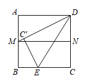

# Mathematics - 题目 2702

**ID**: 0f57be55d0464dd195fcdd412ee1dccb
**年级**: Grade 9
**难度**: Medium
**题型**: Fill-in-the-blank

## 题目
如图，将正方形ABCD对折后展开，得折痕MN，连结MD．点E在边BC上，连接DE，将△DEC沿DE折叠，当点C的对应点C′落在∠DMN的边上时，则 $\frac {EC}{BC}$ 的值为．​​​​​​​‌

## 解答

1. 解：如图，设正方形ABCD的边长为a，ED与MN交于点P，
2. 
3. ∵MN∥BC，且M为AB的中点，
4. ∴ $\frac {NP}{EC}=\frac {ND}{CD}=\frac {1}{2}$ ，
5. 过点P作PQ⊥DM于Q，
6. 由折叠的性质知：DE平分∠CDM，
7. ∴PN=PQ，
8. 设PN=PQ= $\frac {1}{2}$EC=x，
9. ∴PM=MN-PN=a-x，
10. ∵DM= $\sqrt {AD{^{2}}+AM{^{2}}}$ = $\sqrt {a{^{2}}+{\left({\frac {a}{2}}\right)^{2}}}=\frac {\sqrt {5}}{2}a$ ，
11. ∴sin∠DMN= $\frac {DN}{DM}=\frac {PQ}{PM}$ ，即 $\frac {\frac {a}{2}}{\frac {\sqrt {5}}{2}a}=\frac {x}{a-x}$ ，
12. 解得x= $\frac {a}{\sqrt {5}+1}$ = $\frac {\sqrt {5}-1}{4}a$ ，
13. 经检验x= $\frac {\sqrt {5}-1}{4}a$ 是原方程的解，
14. ∴EC=2x= $\frac {\sqrt {5}-1}{2}a$ ，
15. ∴ $\frac {EC}{BC}=\frac {\frac {\sqrt {5}-1}{2}a}{a}=\frac {\sqrt {5}-1}{2}$ ，
16. 故答案为： $\frac {\sqrt {5}-1}{2}$ ．

## 知识点

**中文**:
  - 平行线分线段成比例定理
  - 正方形的性质
  - 正弦
  - 解直角三角形

**English**:
  - Parallel Lines Intercept Theorem
  - Properties of Squares
  - Sine
  - Solving Right Triangles

---
