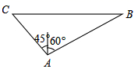

# Mathematics - 题目 1448

**ID**: 12c4ff18e952489aae3bc91ff7f7d4b4
**年级**: Grade 9
**难度**: Medium
**题型**: Fill-in-the-blank

## 题目
一艘轮船在小岛 $A$ 的北偏东 $60{}^\circ $ 方向距小岛 $60$ 海里的 $B$ 处，沿正西方向航行 $3$ 小时后到达小岛的北偏西 $45{}^\circ $ 的 $C$ 处，则该船行驶的速度为海里/小时．​​​​​​​‌

## 解答

1. 如图，过点A作 $AD\bot BC$ 于点D，
2. 由题意得： $\angle BAD=60{}^\circ ,\angle CAD=45{}^\circ $ ， $AB=60$ 海里，
3. $\because $ 在 $\mathrm{R}\mathrm{t}△ABD$ 中， $\angle B=90{}^\circ -\angle BAD=30{}^\circ $ ， $AB=60$ 海里，
4. $\therefore AD=\frac {1}{2}AB=30$ 海里， $BD=\sqrt {AB{^{2}}-AD{^{2}}}=30\sqrt {3}$ 海里，
5. $\because $ 在 $Rt△ACD$ 中， $\angle CAD=45{}^\circ $ ，
6. $\therefore Rt\mathrm{△}ACD$ 是等腰直角三角形，
7. $\therefore CD=AD=30$ 海里，
8. $\therefore BC=CD+BD=(30+30\sqrt {3})$ 海里，
9. 则该船行驶的速度为 $\frac {BC}{3}=\left ({10+10\sqrt {3}}\right )$ 海里/小时，
10. 故答案为： $\left ({10+10\sqrt {3}}\right )$ ．
11. 

## 知识点

**中文**:
  - 含30度角的直角三角形
  - 方位角
  - 等腰三角形的判定与性质

**English**:
  - Right Triangle with 30° Angle
  - Azimuth / Bearing
  - Determination and Properties

---
