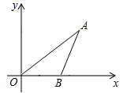

# Mathematics - 题目 631

**ID**: 1710360d37f843c09510cedd26070e75
**年级**: Grade 9
**难度**: Medium
**题型**: Fill-in-the-blank

## 题目
如图，已知点 $A$ 坐标为 $\left ({\sqrt {3},1}\right )$ ， $B$ 为 $x$ 轴正半轴上一动点，则 $\angle AOB$ 度数为，在点 $B$ 运动的过程中 $AB+\frac {1}{2}OB$ 的最小值为．​​​​​​​‌

## 解答

1. 解：过点A作A关于x轴的对称点C，交x轴于点D，过点C作CM⊥OA于点M，交x轴于点B，
2. 
3. ∵点 $A$ 坐标为 $\left ({\sqrt {3},1}\right )$ ，AD⊥x轴，
4. ∴AD=1，OD= $\sqrt {3}$ ，
5. ∴在Rt△AOD中，
6. ${\tan}∠{\rm{A}}{\rm{O}}{\rm{B}}{\rm{=}}\frac {{\rm{A}}{\rm{D}}}{{\rm{O}}{\rm{D}}}{\rm{=}}\frac {\sqrt {3}}{3}$ ，
7. ∴∠AOB=30°；
8. ∵CM⊥OA，
9. ∴∠OMB=∠AMB=90°，
10. ∴BM= $\frac {1}{2}{\rm{O}}{\rm{B}}$ ，
11. ∵∠OBM=∠DBC，
12. ∴∠ACM=30°，
13. ∵A，C关于x轴对称，
14. ∴AB=BC，AD=CD=1，
15. ∴AC=2，
16. ∴ $AB+\frac {1}{2}OB{\rm{=}}{\rm{B}}{\rm{C}}{\rm{+}}{\rm{B}}{\rm{M}}$ ，
17. ∴当C，B，M三点共线时， $AB+\frac {1}{2}OB$ 有最小值，即CM长，
18. 在Rt△ACM中，
19. CM= ${\rm{A}}{\rm{C}}\times {\cos}30{^{\circ }}{\rm{=}}2\times \frac {\sqrt {3}}{2}{\rm{=}}\sqrt {3}$ ，
20. 故答案为：30°； $\sqrt {3}$ .

## 知识点

**中文**:
  - 解直角三角形

**English**:
  - Solving Right Triangles

---
