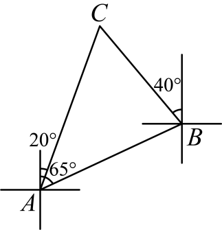

# Mathematics - 题目 1886

**ID**: 1a19ed36158541d5a669b392ac16a591
**年级**: Grade 9
**难度**: Medium
**题型**: Fill-in-the-blank

## 题目
如图，一艘船由A港沿北偏东 $65{}^\circ $ 方向航行 $60\sqrt {2}{\rm{k}}{\rm{m}}$ 至 $B$ 港，然后再沿北偏西 $40{}^\circ $ 方向航行至 $C$ 港， $C$ 港在A港北偏东 $20{}^\circ $ 方向，则 $A，C$ 两港之间的距离为${\rm{k}}{\rm{m}}$ ．​​​​​​​‌

## 解答

1. 解：如图，设过A点正北方向直线为 $AD$ ，过 $B$ 点正北方向直线为 $BG$ ，过 $B$ 作 $BE\bot AC$ 于 $E$ ，过 $C$ 作 $\mathrm{C}\mathrm{F}\mathrm{/\mskip-4mu/}\mathrm{A}\mathrm{D}$ ，
2. 
3. 由题意得： $\angle DAB=65{}^\circ $ ， $\angle ADC=20{}^\circ $ ， $\angle CBG=40{}^\circ $ ， $AB=60\sqrt {2}{\rm{k}}{\rm{m}}$ ，
4. $\therefore \angle CAB=\angle DAB-\angle DAC=65{}^\circ -20{}^\circ =45{}^\circ $ ，
5. $\because BE\bot AC$ ，
6. $\therefore \angle AEB=\angle CEB=90{}^\circ $ ，
7. $\therefore \vartriangle AEB$ 是等腰直角三角形，
8. $\therefore AE=BE=\frac {\sqrt {2}}{2}AB=60{\rm{k}}{\rm{m}}$ ，
9. $\because CF\mathrm{/\mskip-4mu/}AD\mathrm{/\mskip-4mu/}BG$ ，
10. $\therefore \angle ACF=\angle DAC=20{}^\circ $ ， $\angle BCF=\angle CBG=40{}^\circ $ ，
11. $\therefore \angle BCE=\angle BCF+\angle ACF=40{}^\circ +20{}^\circ =60{}^\circ $ ，
12. $\therefore $ 在 ${\rm{R}}{\rm{t}}\vartriangle BCE$ 中， ${\tan}\angle BCE={\tan}60{}^\circ =\frac {BE}{CE}=\frac {60}{CE}=\sqrt {3}$ ，
13. $\therefore CE=20\sqrt {3}{\rm{k}}{\rm{m}}$ ，
14. $\therefore AC=AE+CE=\left ({60+20\sqrt {3}}\right ){\rm{k}}{\rm{m}}$ ，
15. 故此题答案为： $\left ({60+20\sqrt {3}}\right )$ ．

## 知识点

**中文**:
  - 方位角
  - 解直角三角形
  - 解直角三角形的实际应用

**English**:
  - Azimuth / Bearing
  - Solving Right Triangles
  - Applications of Solving Right Triangles

---
