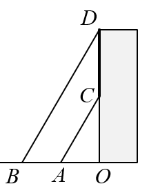

# Mathematics - 题目 860

**ID**: 1acf01fdf5704c0cbe1be61023373950
**年级**: Grade 9
**难度**: Medium
**题型**: Fill-in-the-blank

## 题目
如图，小石同学在 $A，B$ 两点分别测得某建筑物上条幅两端 $C，D$ 两点的仰角均为 $60{}^\circ $ ，若点 $O,A,B$ 在同一直线上， $A，B$ 两点间距离为3米，则条幅的高 $CD$ 为米（结果可以保留根号）​​​​​​​‌

## 解答

1. 过点C作CE∥AB，交BD于点E，
2. ∵小石同学在 $A，B$ 两点分别测得某建筑物上条幅两端 $C，D$ 两点的仰角均为 $60{}^\circ $ ，
3. ∴∠CAO=∠DBO=60°，
4. ∴AC∥BD，
5. ∴四边形ABEC是平行四边形，
6. ∴CE=AB=3，∠DEC=60°，
7. ∵BO⊥DO，
8. ∴EC⊥DO，
9. ∴在直角 $\vartriangle DEC$ 中，CD=EC×tan60°=3 $\sqrt {3}$ ，
10. 故答案是：3 $\sqrt {3}$ ．
11. 

## 知识点

**中文**:
  - 解直角三角形的实际应用

**English**:
  - Applications of Solving Right Triangles

---
