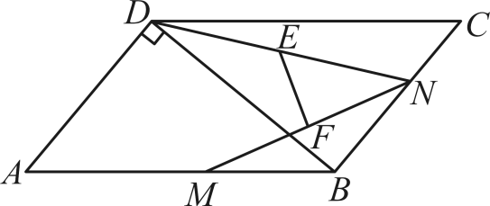

# Mathematics - 题目 387

**ID**: 1b077edd87b74dcc82fb6eb009feeeb9
**年级**: Grade 9
**难度**: Medium
**题型**: Fill-in-the-blank

## 题目
如图，在平行四边形 $ABCD$ 中， $AD=6,BD=8,AD\bot DB$ ，点 $M、N$ 分别是边 $AB、BC$ 上的动点（不与 $A、B、C$ 重合），点 $E、F$ 分别为 $DN、MN$ 的中点，连接 $EF$ ，则 $EF$ 的最小值为．​​​​​​​‌

## 解答

1. 解：连接 $DM$ ，
2. 
3. ∵点 $E、F$ 分别为 $DN、MN$ 的中点，
4. ∴ $EF=\frac {1}{2}DM$ ，
5. 当 $DM⊥AB$ 时， $DM$ 最小，则 $EF$ 最小，
6. ∵ $AD=6,BD=8,AD\bot DB$ ，
7. ∴ $AB=\sqrt {AD{^{2}}+BD{^{2}}}=10$ ，
8. 设 $\mathrm{△}ABD$ 中 $AB$ 边上高为h，
9. 则 $S{{}_{\vartriangle ABD}}=\frac {1}{2}AD\cdot BD=\frac {1}{2}AB\cdot h$ ，
10. ∴ $\frac {1}{2}\times 6\times 8=\frac {1}{2}\times 10h$ ，
11. ∴ $h=4.8$ ，
12. ∴ $DM$ 最小值为 $4.8$ ，则 $EF$ 最小值为 $\frac {1}{2}\times 4.8=2.4$

## 知识点

**中文**:
  - 三角形中位线
  - 勾股定理
  - 平行四边形的对边平行且相等

**English**:
  - Triangle Midsegment
  - Pythagorean Theorem
  - Opposite Sides Parallel and Equal

---
