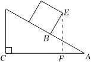

# Mathematics - 题目 1087

**ID**: 23c51e7ecb614eaa9cfe594996718989
**年级**: Grade 9
**难度**: Medium
**题型**: Fill-in-the-blank

## 题目
如图，一个高 $BE$ 为 $\sqrt {3}$ 米的长方体木箱沿坡比为 $1:\sqrt {3}$ 的斜面下滑，当木箱滑至如图位置时， $AB=3$ 米，则木箱端点 $E$ 距地面 $AC$ 的高度 $EF$ 为米．​​​​​​​‌

## 解答

1. 解：设 $AB$ 、 $EF$ 交于点 $D$ ，
2. 
3. ∵斜坡的坡比为 $1:\sqrt {3}$ ，
4. ∴ ${\tan}\angle DAF=\frac {1}{\sqrt {3}}=\frac {\sqrt {3}}{3}$ ，
5. ∴ $\angle DAF=30{}^\circ $ ，
6. ∴ $\angle ADF=90{}^\circ -30{}^\circ =60{}^\circ $ ，
7. ∴ $\angle BDE=60{}^\circ $ ，
8. 在 $Rt\vartriangle BDE$ 中， ${\sin}\angle BDE=\frac {BE}{DE}$ ，
9. ∴ $\frac {\sqrt {3}}{DE}=\frac {\sqrt {3}}{2}$ ，
10. 解得， $DE=2$ （米），
11. ∴ $BD=1$ （米），
12. ∴ $AD=AB-BD=2$ （米），
13. 在 $Rt\vartriangle ADF$ 中， $\angle DAF=30{}^\circ $ ，
14. ∴ $DF=\frac {1}{2}AD=1$ （米），
15. ∴ $EF=DE+DF=3$ （米），
16. 故答案为：3．

## 知识点

**中文**:
  - 正弦
  - 解直角三角形

**English**:
  - Sine
  - Solving Right Triangles

---
