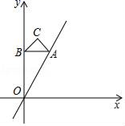

# Mathematics - 题目 1720

**ID**: 2d98afa5e8784772a243fcd02f7524dd
**年级**: Grade 9
**难度**: Medium
**题型**: Fill-in-the-blank

## 题目
如图，A是正比例函数y= $\frac {3}{2}$ x图象上的点，且在第一象限，过点A作AB⊥y轴于点B，以AB为斜边向上作等腰直角三角形ABC，若AB=2，则点C的坐标为．​​​​​​​‌

## 解答

1. ∵A是正比例函数 $y=\frac {3}{2}x$ 图象上的点，且在第一象限， $AB=2，$
2. ∴点A的横坐标是2，
3. 当x=2时，y=3，
4. ∴点A的坐标为（2，3），
5. ∵过点A作AB⊥y轴于点B，以AB为斜边向上作等腰直角三角形ABC，
6. ∴点C到AB的距离为1，AB的一半是1，
7. ∴点C的坐标是（1，4）
8. 故答案为（1，4）．

## 知识点

**中文**:
  - 坐标与图形性质
  - 正比例函数图象和性质
  - 等腰直角三角形的性质

**English**:
  - Coordinates and Geometric Properties
  - Graphs and Properties of Direct Proportion Functions
  - Properties of Isosceles Right Triangles

---
