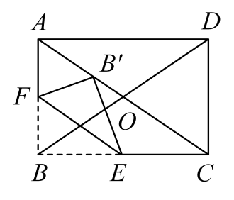

# Mathematics - 题目 2459

**ID**: 31c3676e53364076aac0e6ea05beaacf
**年级**: Grade 9
**难度**: Medium
**题型**: Fill-in-the-blank

## 题目
矩形 $ABCD$ 中，对角线 $AC$ ， $BD$ 交于点 $O$ ， $AD=6$ ， $AB=4$ ，点 $E$ 为边 $BC$ 中点，动点 $F$ 从点 $B$ 出发，沿 $B\to A\to D$ 的方向在边 $BA$ ， $AD$ 上以每秒1个单位的速度运动，设运动时间为 $t$ 秒，将矩形沿 $EF$ 折叠，点 $B$ 的对应点为 $B′$ ，当点 $B′$ 落在矩形对角线上时（不与矩形顶点重合），则 $t$ 的值为秒．​​​​​​​‌

## 解答

1. 解：如图1，当点 $B^{′}$ 落在矩形对角线 $AC$ 上时，连接 $BB^{′}$ ，
2. 
3. 由翻折可得 $B^{′}E=BE$ ，
4. ∵点E为 $BC$ 中点，
5. ∴ $B^{′}E=BE=EC$ ，
6. ∴ $\angle BB^{′}C=90{}^\circ $ ，
7. ∵ $BB^{′}{\bot }EF$ ，
8. ∴ $EF/\mskip-4mu/AC$ ，
9. ∴F为 $AB$ 中点，
10. ∴ $BF=\frac {1}{2}AB=2$ ，
11. ∴ $t=2$ ；
12. 如图2，
13. 
14. 当点 $B^{′}$ 落在矩形对角线 $BD$ 上时， $EF\bot BD$ 时，作 $FG\bot BE$ 于点G，
15. ∴ $\angle EFG=90{}^\circ -\angle FEG=\angle CBD$ ，
16. ∴ ${\tan}\angle EFG={\tan}\angle CBD$ ，
17. ∴ $\frac {GE}{FG}=\frac {CD}{BC}=\frac {4}{6}=\frac {2}{3}$ ，
18. ∴ $\frac {FG}{GE}=\frac {3}{2}$ ，
19. ∵ $BG=AF=t-4$ ， $BE=\frac {1}{2}BC=3$ ，
20. ∴ $GE=BE-BG=7-t$ ，
21. ∵ $FG=AB=4$ ，
22. ∴ $\frac {4}{7-t}=\frac {3}{2}$ ，
23. 解得 $t=\frac {13}{3}$ ．

## 知识点

**中文**:
  - 平行线分线段成比例定理
  - 正切
  - 折叠问题

**English**:
  - Parallel Lines Intercept Theorem
  - Tangent
  - Folding Problems

---
