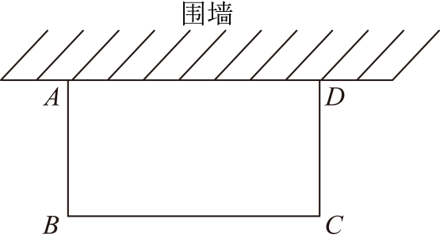

# Mathematics - 题目 1011

**ID**: 346ca07a112f44a2a3f919d9506a3147
**年级**: Grade 9
**难度**: Medium
**题型**: Fill-in-the-blank

## 题目
如图，学校要在校园内建一个矩形的开心农场，其中一边 $AD$ 是围墙，且 $AD$ 的长不能超过 $28{\rm{m}}$ ，其余三边 $AB$ ， $BC$ ， $CD$ 用 $60{\rm{m}}$ 长的铁质栅栏．有下列结论：① $AB$ 的长可以为 $15{\rm{m}}$ ；​​​​​​​‌②当农场 $ABCD$ 面积为 $200{\rm{m}}{^{2}}$ 时，满足条件的 $AB$ 的长只有一个值；③农场 $ABCD$ 面积的最大值为 $450{\rm{m}}{^{2}}$ ；④若把农场的形状改成半圆形，且直径一侧利用已有围墙，则农场的面积可以超过 $560{\rm{m}}{^{2}}$ ．其中，正确结论的是．(只需填序号)

## 解答

1. 解：设 $AD$ 边长为 $x$   $m,$ 则 $AB$ 边长为长为 $\frac {60-x}{2}{\rm{m}}$ ，
2. 当 $AB=15$ 时， $\frac {60-x}{2}=15$ ，
3. 解得 $x=30$ ，
4. $\because AD$ 的长不能超过 $28{\rm{m}}$ ，
5. $\therefore x\leqslant 28$ ，
6. 故①不正确．
7. $\because $ 菜园 $ABCD$ 面积为 $200{\rm{m}}{^{2}}$ ，
8. $\therefore x\cdot \frac {60-x}{2}=200$ ．
9. 解得： $x=30\pm 10\sqrt {5}$ ．
10. 又 $x\leqslant 28$ ，
11. $\therefore $  $x=30-10\sqrt {5}$ ．
12. $\therefore $ 满足条件的 $AB$ 的长只有一个值，故②正确．
13. 由题意，设矩形菜园的面积为 $y{\rm{\;}}{\rm{m}}{^{2}}$ ，
14. 根据题意得： $y=x\cdot \frac {60-x}{2}=-\frac {1}{2}{\left({x-30}\right)^{2}}+450$
15. $\because -\frac {1}{2}<0$ ， $x\leqslant 28$ ，
16. $\therefore $ 当 $x=28$ 时， $y$ 有最大值，最大值为 $448{\rm{m}}{^{2}}$ 不可能为 $450{\rm{m}}{^{2}}$ ．
17. 故③不正确．
18. $\because $ 直径一侧是围墙，当直径取最大值 $28$ 时，半圆的弧长为 $\frac {1}{2}π\times 28<60$ ，
19. $\therefore $ 设沿 $AD$ 方向栅栏延伸 $a$ 米，则 $\frac {1}{2}π\left ({28+a}\right )=60-a$
20. $\therefore a\approx 10.2$ ．
21. $\therefore $ 农场的最大面积为 $\frac {1}{2}π{\left({28+a}\right)^{2}}\approx 573>560$ ．
22. $\therefore $ 农场的面积可以超过 $560{\rm{m}}{^{2}}$
23. 故④正确．

## 知识点

**中文**:
  - 二次函数的最值
  - 因式分解法解一元二次方程
  - 图形问题
  - 几何问题

**English**:
  - Maximum/Minimum of Quadratic Functions
  - Solving by Factorization
  - Geometric Problems
  - Geometry Problems

---
