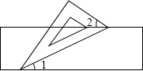

# Mathematics - 题目 3777

**ID**: 35f644a0a9134f84bc5f75af3f62fcc8
**年级**: Grade 9
**难度**: Medium
**题型**: Fill-in-the-blank

## 题目
如图，有一块含有30°角的直角三角板的两个顶点放在直尺的对边上．如果∠2=28°，那么∠1的度数是．​​​​​​​‌

## 解答

1. 如图，∵∠ABC=60°，∠2=28°，
2. ∴∠EBC=32°，
3. ∵BE∥CD，
4. ∴∠1=∠EBC=32°，
5. 故答案为：32°．
6. 

## 知识点

**中文**:
  - 余角和补角
  - 角的运算

**English**:
  - Complementary and Supplementary Angles
  - Operations with Angles

---
