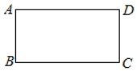

# Mathematics - 题目 974

**ID**: 3eee19ea878c43b1a1d0b156fbf02f6d
**年级**: Grade 9
**难度**: Medium
**题型**: Fill-in-the-blank

## 题目
如图，在矩形ABCD中，AB＝2，BC＝4，边AD，BC上分别有E，F两点，若直线EF恰好平分矩形ABCD的面积，且与AD的夹角为60°时，则AE的长度为．​​​​​​​‌

## 解答

1. 解：如图所示：过E、F分别作EG⊥BC、FH⊥AD，交BC、AD于G、H，
2. 
3. ∵EF恰好平分矩形ABCD的面积，
4. ∴梯形AEFB的面积与梯形CFED的面积相等且等于矩形ABCD面积的一半，
5. 即S_{四}_{边}_{形}AEFB＝S_{四}_{边}_{形}CFED＝ $\frac {1}{2}$ ×2×4＝4，且AE＝FC，BF＝ED，
6. 又∵在Rt△EFH中，HF＝AB＝2，
7. ∴HE＝HF•tan30°＝2× $\frac {\sqrt {3}}{3}$ ＝ $\frac {2\sqrt {3}}{3}$ ，
8. 又∵S_{梯形}ABFE＝ $\frac {1}{2}$ ×（AE＋BF）×HF＝ $\frac {1}{2}$ ×2×（AE＋BF）＝AE＋BF＝4，
9. AE＝AH＋HE＝BF＋HE，
10. AE＋ED＝AH＋HE＋ED＝2AH＋HE＝4，
11. ∴2AH＋ $\frac {2\sqrt {3}}{3}$ ＝4，
12. AH＝2﹣ $\frac {\sqrt {3}}{3}$ ，
13. ∴AE＝AH＋HE＝2﹣ $\frac {\sqrt {3}}{3}$ ＋ $\frac {2\sqrt {3}}{3}$ ＝2＋ $\frac {\sqrt {3}}{3}$ ．
14. 故答案为：2＋ $\frac {\sqrt {3}}{3}$ ．

## 知识点

**中文**:
  - 矩形的性质
  - 解直角三角形

**English**:
  - Properties of Rectangles
  - Solving Right Triangles

---
