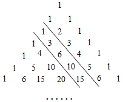

# Mathematics - 题目 3616

**ID**: 404b80719cd64b5aa8a20faf245448ff
**年级**: Grade 9
**难度**: Medium
**题型**: Fill-in-the-blank

## 题目
右表被称为“杨辉三角”或“贾宪三角”．其规律是：从第三行起，每行两端的数都是“1”，其余各数都等于该数“两肩”上的数之和．表中两平行线之间的一列数：1，3，6，10，15，……，我们把第一个数记为 $a{{}_{1}}$ ，第二个数记为 $a{{}_{2}}$ ，第三个数记为 $a{{}_{3}}$ ，……，第 $n$ 个数记为 $a{{}_{n}}$ ，则 $a{{}_{4}}+a{{}_{200}}=$．​​​​​​​‌

## 解答

1. 由已知数据1，3，6，10，15，……，可得 $a{{}_{n}}=\frac {n\left ({n+1}\right )}{2}$ ，
2. ∴ $a{{}_{4}}=\frac {4\times 5}{2}=10$ ， $a{{}_{200}}=\frac {200\times 201}{2}=20100$ ，
3. ∴ $a{{}_{4}}+a{{}_{200}}=20100{\rm{+}}10{\rm{=}}20110$ ．
4. 故答案为20110．

## 知识点

**中文**:
  - 列代数式
  - 规律型：数与式的变化类

**English**:
  - Writing Algebraic Expressions
  - Patterns: Number and Expression Variations

---
