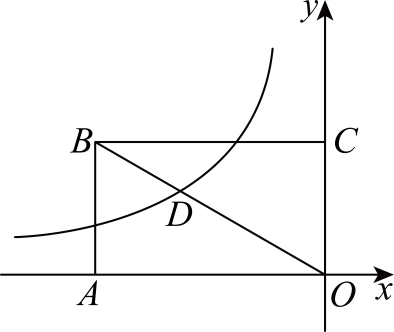

# Mathematics - 题目 1361

**ID**: 465ec36d845a487bb9092e5f6e86cae0
**年级**: Grade 9
**难度**: Medium
**题型**: Fill-in-the-blank

## 题目
如图，矩形 $OABC$ 的对角线 $OB$ 与双曲线 $y=\frac {k}{x}\left ({x<0}\right )$ 相交于点 ${\rm \mathit{D}}$ ，已知 $S{{}_{矩形OABC}}=50{\rm ，}$ 且 $OD:BD=3:2{\rm ，}$ 则 $k=$．​​​​​​​‌

## 解答

1. 解：过点 ${\rm \mathit{D}}$ 作 $DE\bot OA$ 于 $E{\rm ，}$
2. 
3. ∵矩形 $OABC{\rm ，}$  $AB\bot AO{\rm ，}$
4. ∴ $DE{\rm{/\mskip-4mu/}}BA{\rm ，}$
5. ∴ $\vartriangle ODE∽\vartriangle OBA{\rm ，}$
6. ∵ $OD:BD=3:2{\rm ，}$
7. ∴ $\frac {OD}{OB}=\frac {3}{5}{\rm ，}$
8. ∴ $\frac {S{{}_{\vartriangle ODE}}}{S{{}_{\vartriangle OBA}}}=(\frac {OD}{OB}){^{2}}=\frac {9}{25}{\rm ，}$
9. ∵ $S{{}_{\vartriangle OBA}}=\frac {1}{2}\times 50=25{\rm ，}$
10. 则 $S{{}_{\vartriangle ODE}}=9{\rm ，}$
11. ∵ $\frac {1}{2}\left |{k}\right |=9{\rm ，}$
12. ∴ $k=\pm 18{\rm ，}$
13. ∵ $k<0{\rm ，}$
14. ∴ $k=-18$

## 知识点

**中文**:
  - 反比例函数综合
  - 反比例函数解析式
  - 相似三角形的判定与性质综合

**English**:
  - Comprehensive Inverse Proportionality Problems
  - Analytic Expression of Inverse Proportionality
  - Determination and Properties

---
