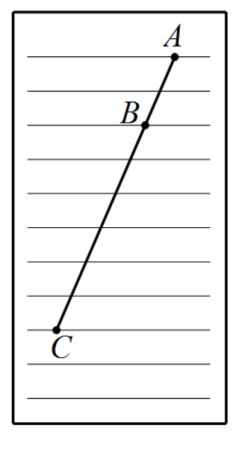

# Mathematics - 题目 379

**ID**: 4c5c2392b971460e81879fa241cee502
**年级**: Grade 9
**难度**: Medium
**题型**: Fill-in-the-blank

## 题目
如图，练习本中的横格线都平行，且相邻两条横格线间的距离都相等，同一条直线上的三个点A、B、C都在横格线上，若线段AB=4 cm，则线段BC=cm​​​​​​​‌

## 解答

1. 解：如图，过点A作 $AE\bot CE$ 于点 $E$ ，交 $BD$ 于点 $D$ ，
2. 
3. $\because $ 练习本中的横格线都平行，且相邻两条横格线间的距离都相等，
4. $\therefore $  $\frac {AB}{BC}=\frac {AD}{DE}$ ，
5. 即 $\frac {4}{BC}=\frac {2}{6}$ ，
6. $\therefore BC=12{\rm{c}}{\rm{m}}$ ．
7. 故此题答案为：12

## 知识点

**中文**:
  - 平行线分线段成比例定理

**English**:
  - Parallel Lines Intercept Theorem

---
