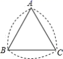

# Mathematics - 题目 2500

**ID**: 4c76243b9dc845ac94d18f14358e3932
**年级**: Grade 9
**难度**: Medium
**题型**: Fill-in-the-blank

## 题目
如图所示的曲边三角形可按下述方法作出：作等边三角形 $ABC$ ；​​​​​​​‌分别以点 $A$ ， $B$ ， $C$ 为圆心，以 $AB$ 的长为半径作 $\widehat {BC}$ ， $\widehat {AC}$ ， $\widehat {AB}$ ．三段弧所围成的图形就是一个曲边三角形，如果一个曲边三角形的周长为 $2π$ ，那么这个曲边三角形的面积是．

## 解答

1. ∵曲边三角形的周长为 $2π$
2. ∴一条曲边的长为： $\frac {2}{3}$ π
3. ∵△ABC是等边三角形，∴∠A=∠B=∠C=60°，即一段弧对应的圆心角为60°
4. ∴ $\frac {60{}^\circ }{360{}^\circ }�2πr=\frac {2}{3}$ π
5. 解得：r=2，即AB=BC=AC=2
6. 如下图，阴影部分是以A为圆心的扇形
7. 
8. 面积为： $\frac {60{}^\circ }{360{}^\circ }�π�2{^{2}}=\frac {2}{3}$ π
9. 同样以点B、C为圆心的扇形面积也为： $\frac {2}{3}$ π
10. 则这三个扇形面积和为：2π
11. 发现，三个扇形面积相加，中间的△ABC的面积计算了3次，我们还需要减去2次
12. 如下图，过点A作BC的垂线，交BC于点D
13. 
14. ∵等边△ABC的边长为2
15. ∴CD=1，AD= $\sqrt {3}$
16. ∴△ABC的面积= $\frac {1}{2}�2�\sqrt {3}$ = $\sqrt {3}$
17. ∴曲边三角形的面积=2π-2 $\sqrt {3}$
18. 故答案为： $2π-2\sqrt {3}$

## 知识点

**中文**:
  - 弧长公式
  - 扇形面积的计算

**English**:
  - Arc Length Formula
  - Sector Area Calculation

---
