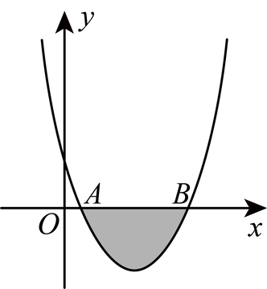

# Mathematics - 题目 1583

**ID**: 5420a7070d914c98a1b4793e60136011
**年级**: Grade 9
**难度**: Medium
**题型**: Fill-in-the-blank

## 题目
如图，抛物线 $y=x{^{2}}-3kx+6k-5$ 与 $x$ 轴相交于 $A、B$ 两点，当抛物线与 $x$ 轴围成的区域（阴影部分）面积最小时， $k$ 的值为．​​​​​​​‌

## 解答

1. 解：当 $y=0$ 时， $x{^{2}}-3kx+6k-5=0$ ，
2. ∴ $x{{}_{1}}+x{{}_{2}}=3k$ ， $x{{}_{1}}x{{}_{2}}=6k-5$ ，
3. ∴ ${\left({x{{}_{1}}-x{{}_{2}}}\right)^{2}}={\left({x{{}_{1}}+x{{}_{2}}}\right)^{2}}-4x{{}_{1}}x{{}_{2}}={\left({3k}\right)^{2}}-4\left ({6k-5}\right )=9k{^{2}}-24k+20$ ，
4. ∴ $AB=\sqrt {9k{^{2}}-24k+20}=\sqrt {{\left({3k-4}\right)^{2}}+4}$ ，
5. 当 $AB$ 取最小值时，抛物线的顶点到 $AB$ 的距离最小，此时阴影部分的面积最小，
6. ∴ $3k-4=0$ ，
7. ∴ $k=\frac {4}{3}$ .

## 知识点

**中文**:
  - 一元二次方程根与系数的关系
  - 二次函数与一元二次方程
  - 图形问题

**English**:
  - Relationship between Roots and Coefficients (Vieta's Formulas)
  - Quadratic Functions and Quadratic Equations
  - Geometric Problems

---
