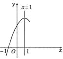

# Mathematics - 题目 3940

**ID**: 552be52e34e64d3f82552bf3a53754b3
**年级**: Grade 9
**难度**: Medium
**题型**: Fill-in-the-blank

## 题目
二次函数 $y=ax{^{2}}+bx+c$  $\left ({a\ne 0}\right )$ 图象的一部分如图所示．已知图象经过点 $\left ({-1,0}\right )$ ，对称轴为直线 $x=1$ ．下列结论：① $abc<0$ ；​​​​​​​‌② $4a+2b+c=0$ ；③若抛物线经过点 $\left ({-3,n}\right )$ ，则关于x的一元二次方程 $ax{^{2}}+bx+c-n=0\left ({a\ne 0}\right )$ 的两根分别是 $-3,5$ ；其中正确结论的序号是．

## 解答

1. 由图像和题目得：
2. a＜0， $-\frac {b}{2a}=1$ ，c＞0
3. 得： $b=-2a$
4. ∴b＞0
5. ∴ $abc<0$
6. ①正确
7. $x=2$ 时， $y=4a+2b+c$
8. ∵抛物线对称轴为 $x=1$
9. ∴ $x=0$ 时，对应的y值与 $x=2$ 时一样
10. $x=0$ 时， $y＞0$
11. ∴ $x=2$ 时， $y＞0$
12. 即 $4a+2b+c＞0$
13. ②错误
14. ∵抛物线经过点 $\left ({-3,n}\right )$
15. 该点关于对称轴对称的点为 $\left ({5,n}\right )$
16. ∴ $ax{^{2}}+bx+c=n$ 的解为 $x{{}_{1}}=-3，x{{}_{2}}=5$
17. ∴ $ax{^{2}}+bx+c-n=0$ 的解为 $x{{}_{1}}=-3，x{{}_{2}}=5$
18. ③正确
19. 故答案为：①③

## 知识点

**中文**:
  - y=ax²+bx+c的图象与性质
  - 二次函数的图象与系数之间的关系

**English**:
  - Graph and Properties of y=ax²+bx+c
  - Relationship between Graphs and Coefficients

---
