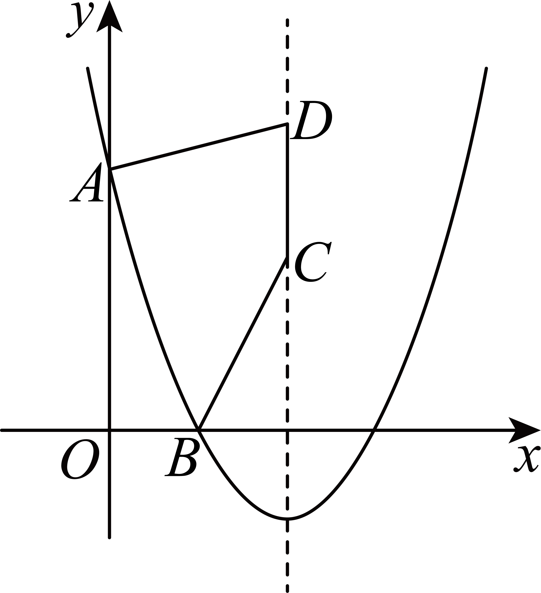

# Mathematics - 题目 730

**ID**: 57d626edc285405092e5b7473731c34b
**年级**: Grade 9
**难度**: Medium
**题型**: Fill-in-the-blank

## 题目
如图，抛物线 $y=\frac {1}{2}x{^{2}}-4x+6$ 与y轴交于点A，与x轴交于点B，线段 $CD$ 在抛物线的对称轴上移动（点C在点D下方），且 $CD=3$ ．当 $AD+BC$ 的值最小时，点C的坐标为．​​​​​​​‌

## 解答

1. 解： $y=\frac {1}{2}x{^{2}}-4x+6=\frac {1}{2}{\left({x-4}\right)^{2}}-2$ ，
2. ∴对称轴为 $x=4$ ，
3. 如图，设抛物线与x轴另一个交点为F，
4. 
5. 当 $x=0$ 时， $y=6$ ，
6. ∴ $A\left ({0,6}\right )$ ，
7. 当 $y=0$ 时， $0=\frac {1}{2}x{^{2}}-4x+6$ ，
8. 解得 $x{{}_{1}}=2$ ， $x{{}_{2}}=6$ ，
9. ∴ $B\left ({2,0}\right )$ ， $F\left ({6,0}\right )$ ，
10. 在y轴上取点 $E\left ({0,3}\right )$ ，连接 $CE$ ， $CF$ ， $EF$ ，
11. ∴ $AE=3=CD$ ，
12. ∵ $CD{\rm{/\mskip-4mu/}}AE$ ，
13. ∴四边形 $AECD$ 是平行四边形，
14. ∴ $AD=CE$ ，
15. ∵抛物线对称轴为 $x=4$ ，
16. ∴ $BC=CF$ ，
17. ∴ $AD+BC=CE+CF\geqslant EF$ ，
18. 当E、C、F三点共线时， $AD+BC$ 最小，
19. 设直线 $EF$ 解析式为 $y=kx+b$ ，
20. ∴ $\begin{cases}6k+b=0\\b=3\end{cases}$ ，
21. 解得 $\begin{cases}\begin{matrix}k=-\frac {1}{2}\\b=3\end{matrix}\end{cases}$ ，
22. ∴ $y=-\frac {1}{2}x+3$ ，
23. 当 $x=4$ 时， $y=-\frac {1}{2}\times 4+3=1$ ，
24. ∴当 $AD+BC$ 最小时，C的坐标为 $\left ({4,1}\right )$ .

## 知识点

**中文**:
  - 二次函数的综合

**English**:
  - Comprehensive Quadratic Function Problems

---
