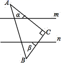

# Mathematics - 题目 30

**ID**: 6411aa9c9a2f4790bba7e00ab390f150
**年级**: Grade 9
**难度**: Medium
**题型**: Fill-in-the-blank

## 题目
如图，m∥n，直角三角板ABC的直角顶点C在两直线之间，两直角边与两直线相交所形成的锐角分别为α、β，则α+β=．​​​​​​​‌

## 解答

1. 如图，过C作CE∥m，
2. 
3. ∵m∥n，
4. ∴CE∥n，
5. ∴∠1=∠α，∠2=∠β，
6. ∵∠1+∠2=90°，
7. ∴∠α+∠β=90°，
8. 故答案为90°．

## 知识点

**中文**:
  - 两直线平行内错角相等
  - 两直线平行同位角相等

**English**:
  - Parallel Lines have Equal Alternate Interior Angles
  - Parallel Lines have Equal Corresponding Angles

---
