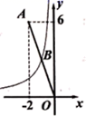

# Mathematics - 题目 101

**ID**: 666cbbf93e954f489694a4ce589ea908
**年级**: Grade 9
**难度**: Medium
**题型**: Fill-in-the-blank

## 题目
如图，在平面直角坐标系中，点A的坐标为(-2，6)，反比例函数 $y=\frac {k}{x}$ (x＜0)的图像经过线段OA的中点B，则k的值为​​​​​​​‌

## 解答

1. 过点A作AC⊥x轴，AD⊥y轴，过点B作BH⊥x轴，BE⊥y轴，
2. ∴AC∥BH，
3. ∵B是OA的中点，
4. ∴OH=CH，
5. ∵A(-2，6),
6. ∴OC=2，
7. ∴OH=1，
8. 同理OE= $\frac {1}{2}$ OD=3，
9. ∴B(-1，3)
10. 将点B的坐标代入 $y=\frac {k}{x}$ ，得k=-3，
11. 故答案为：-3.
12. 

## 知识点

**中文**:
  - 一次函数的实际应用
  - 反比例函数综合
  - 三角形中位线

**English**:
  - Applications of Linear Functions
  - Comprehensive Inverse Proportionality Problems
  - Triangle Midsegment

---
