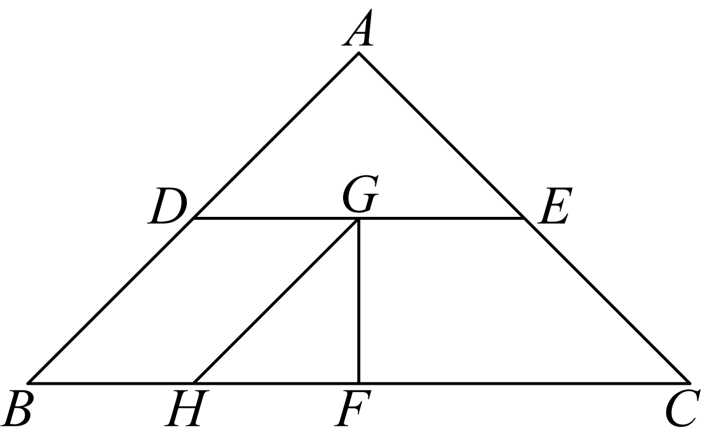

# Mathematics - 题目 2331

**ID**: 6d5891bb00824122a3ed1e9d06438518
**年级**: Grade 9
**难度**: Medium
**题型**: Fill-in-the-blank

## 题目
在某次数学探究活动中，小明将一张斜边为4的等腰直角三角形 $ABC\left ({\angle A=90{}^\circ }\right )$ 硬纸片剪切成如图所示的四块（其中D，E，F分别为 $AB$ ， $AC$ ， $BC$ 的中点，G，H分别为 $DE$ ， $BF$ 的中点），小明将这四块纸片重新组合拼成四边形（相互不重叠，不留空隙），则所能拼成的四边形中周长的最小值为，最大值为．​​​​​​​‌

## 解答

1. 
2. 如图1， $BC=4$ ， $AC=4\times \frac {\sqrt {2}}{2}=2\sqrt {2}$ ， $CI=BD=CE=\frac {1}{2}AC=\sqrt {2}$
3. $DI=BC=4$
4. ∴四边形 $BCID$ 周长= $4+4+2\sqrt {2}{\rm{=}}8{{+}}2\sqrt {2}$ ；
5. 
6. 如图2， $AF=AI=IC=FC=2$
7. ∴四边形 $AFCI$ 周长为 $2\times 4=8$

## 知识点

**中文**:
  - 平行四边形的对边平行且相等
  - 等腰直角三角形的性质

**English**:
  - Opposite Sides Parallel and Equal
  - Properties of Isosceles Right Triangles

---
